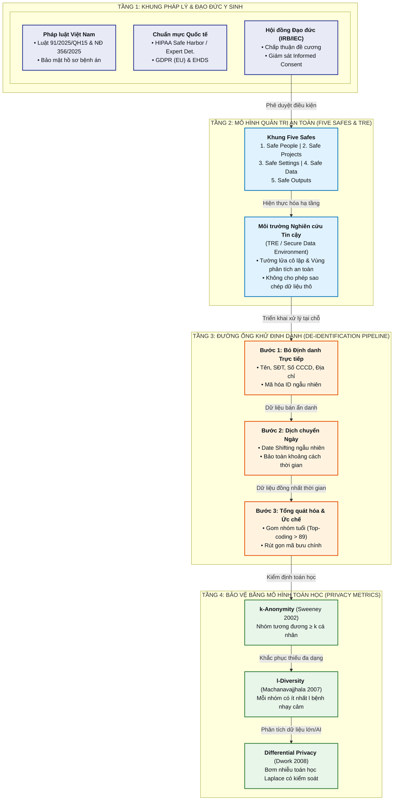

# HƯỚNG DẪN CHUẨN HÓA THIẾT KẾ SƠ ĐỒ MERMAID (MERMAID STYLE GUIDE)

> **Dự án:** Quản lý Dữ liệu Nghiên cứu Y sinh học (Biomedical Research Data Management — RDM)  
> **Áp dụng cho:** Toàn bộ sơ đồ kiến trúc, quy trình và bản đồ khái niệm trong giáo trình  
> **Ngày ban hành:** 22/11/2026  
> **Tác giả:** TS. Hoàng Quang Huy — Đại học Bách khoa Hà Nội (HUST), iBME Lab (ORCID: 0000-0002-4603-1297)

---

## 1. BỐI CẢNH & PHÂN TÍCH CÁC LỖI KINH ĐIỂN CẦN TRÁNH

Trong quá trình kết xuất (rendering) sơ đồ Mermaid trên các nền tảng trực quan hóa (như Quarto HTML, GitHub Markdown, hoặc Antigravity IDE), engine tính toán bố cục (Dagre Layout Engine) thường gặp 4 lỗi nghiêm trọng làm suy giảm trải nghiệm người đọc:

### 1.1. Lỗi 1: Khoảng trống xám khổng lồ (Container Bloating / Huge Blank Space)
- **Hiện tượng:** Một tầng/subgraph có chiều cao bị kéo giãn bất thường, chứa một khoảng xám trống trơn rất lớn ở nửa dưới (xem trường hợp Tầng 2 trong ảnh chụp thực tế).
- **Nguyên nhân gốc rễ:**
  - Sử dụng liên kết trực tiếp giữa các Subgraph (`SUBGRAPH_A --> SUBGRAPH_B`). Mermaid tạo ra một node biên ảo bao quanh toàn bộ subgraph, làm Dagre engine phải kéo giãn kích thước bounding box của subgraph hẹp để khớp với kích thước của subgraph rộng nhất bên cạnh.
  - Các node bên trong subgraph không có mũi tên liên kết nội tại (`direction` mặc định), khiến engine không thể tính toán chiều cao tối ưu.
- **Quy tắc khắc phục:** **Tuyệt đối không dùng liên kết Subgraph-to-Subgraph**. Luôn nối từ một node thực tế của tầng trên xuống node đầu vào của tầng dưới (`NodeA --> NodeB`).

### 1.2. Lỗi 2: Đảo lộn thứ tự quy trình (Pipeline Order Inversion)
- **Hiện tượng:** Các bước quy trình tuần tự bị xếp lộn xộn từ trái sang phải, ví dụ: hiển thị `[Bước 3]` $\rightarrow$ `[Bước 1]` $\rightarrow$ `[Bước 2]`.
- **Nguyên nhân gốc rễ:** Khai báo các bước dưới dạng danh sách node rời rạc trong subgraph mà không có liên kết luồng dữ liệu (`-->`). Mermaid tự do xếp đặt các node không có cạnh nối dựa trên độ dài chuỗi ký tự để tối ưu hóa diện tích hình chữ nhật bao quanh.
- **Quy tắc khắc phục:** Đối với mọi quy trình, đường ống (Pipeline), bắt buộc phải có liên kết chỉ hướng rõ ràng giữa các bước: `STEP1 -->|"Mô tả chuyển đổi"| STEP2 -->|"Mô tả chuyển đổi"| STEP3`, kết hợp chỉ định hướng rõ ràng `direction LR`.

### 1.3. Lỗi 3: Chữ chìm mờ trong Chế độ Nền tối (Dark Mode Low Contrast)
- **Hiện tượng:** Khi người dùng xem tài liệu trên giao diện Dark Mode, chữ trong các khối trở nên mờ xịt, màu xám trắng đè lên nền node màu pastel sáng, khiến văn bản gần như không thể đọc được.
- **Nguyên nhân gốc rễ:** Khai báo lớp màu (`classDef`) chỉ đặt `fill` (màu nền) và `stroke` (màu viền) mà bỏ qua `color` (màu chữ). Trình duyệt hoặc engine Quarto ở chế độ Dark Mode sẽ tự động chuyển màu chữ mặc định sang màu trắng/xám sáng, dẫn đến chữ sáng trên nền sáng.
- **Quy tắc khắc phục:** Mọi `classDef` bắt buộc phải khai báo thuộc tính màu chữ tương phản cao: `color:#0D1117` (mã màu chữ tối đậm, sắc nét) trên nền sáng, hoặc chọn bảng màu hỗ trợ cả Light/Dark mode.

### 1.4. Lỗi 4: Quá tải văn bản trong một Node (Text Overload)
- **Hiện tượng:** Một node chứa quá nhiều dòng mô tả dài, làm kích thước node phình to bất thường, phá vỡ tỷ lệ vàng của sơ đồ.
- **Quy tắc khắc phục:** Mỗi node chỉ chứa: **Tiêu đề in đậm (Bold Title)** + **1 đến 2 gạch đầu dòng cô đọng nhất** (dùng `<br/>• `). Các giải thích dài dòng đưa vào phần văn bản giải trình bên ngoài sơ đồ.

---

## 2. NĂM QUY TẮC VÀNG THIẾT KẾ SƠ ĐỒ MERMAID (5 GOLDEN RULES)

```
Quy tắc 1: Node-to-Node Only      ──▶ Nối giữa node cụ thể, CẤM nối giữa subgraph
Quy tắc 2: Explicit Pipeline Flow ──▶ Luôn dùng mũi tên tuần tự cho các bước quy trình
Quy tắc 3: Dual-Mode High Contrast──▶ Luôn khai báo rõ "color:#0D1117" trong classDef
Quy tắc 4: Concise Node Labels    ──▶ Tối đa 3 dòng text mỗi node (Title + 2 bullet points)
Quy tắc 5: Standardized Palette   ──▶ Dùng bảng 5 màu chuẩn ngữ nghĩa (Law, Arch, Tech, Math, Alert)
```

---

## 3. BẢNG MÃ MÀU CHUẨN NGỮ NGHĨA (SEMANTIC COLOR PALETTE)

Để đảm bảo tính đồng bộ học thuật trên toàn bộ giáo trình, mọi sơ đồ sử dụng bảng màu chuẩn sau (bảo đảm độ tương phản theo chuẩn WCAG 2.1 AA):

| Miền ngữ nghĩa | Tên lớp (`classDef`) | Màu nền (`fill`) | Màu viền (`stroke`) | Màu chữ (`color`) | Mục đích sử dụng |
| :--- | :--- | :--- | :--- | :--- | :--- |
| **Pháp lý & Đạo đức** | `lawStyle` | `#E8EAF6` (Indigo nhạt) | `#283593` (Indigo đậm) | `#0D1117` | Quy định pháp luật, HIPAA, GDPR, IRB |
| **Kiến trúc & Quản trị** | `archStyle` | `#E0F2FE` (Sky Blue nhạt)| `#0277BD` (Sky Blue đậm) | `#0D1117` | Five Safes, TRE, Hạ tầng, REDCap |
| **Kỹ thuật & Pipeline** | `techStyle` | `#FFF3E0` (Orange nhạt) | `#E65100` (Orange đậm) | `#0D1117` | Các bước khử định danh, ETL, MICE |
| **Toán học & Tiêu chuẩn** | `mathStyle` | `#E8F5E9` (Green nhạt) | `#2E7D32` (Green đậm) | `#0D1117` | $k$-Anonymity, $l$-Diversity, FAIR, OMOP |
| **Cảnh báo & Rủi ro** | `warnStyle` | `#FFEBEE` (Red nhạt) | `#C62828` (Red đậm) | `#0D1117` | Lỗi bảng tính, rò rỉ dữ liệu, vi phạm |

**Mẫu khai báo chuẩn đặt ở cuối mỗi khối Mermaid:**
```mermaid
classDef lawStyle fill:#E8EAF6,stroke:#283593,stroke-width:2px,color:#0D1117;
classDef archStyle fill:#E0F2FE,stroke:#0277BD,stroke-width:2px,color:#0D1117;
classDef techStyle fill:#FFF3E0,stroke:#E65100,stroke-width:2px,color:#0D1117;
classDef mathStyle fill:#E8F5E9,stroke:#2E7D32,stroke-width:2px,color:#0D1117;
classDef warnStyle fill:#FFEBEE,stroke:#C62828,stroke-width:2px,color:#0D1117;
```

---

## 4. CASE STUDY THỰC TẾ: TRƯỚC VÀ SAU KHI TỐI ƯU (CHƯƠNG 5)

### 4.1. Mã nguồn Trước khi sửa (Bị lỗi trên ảnh)
```mermaid
%% LỖI: Nối subgraph-to-subgraph, thiếu liên kết bước ở Tầng 3, không có color trong classDef
flowchart TD
    subgraph LAW["TẦNG 1..."] ... end
    subgraph ARCH["TẦNG 2..."] ... end
    subgraph TECH["TẦNG 3..."] ... end
    subgraph MATH["TẦNG 4..."] ... end
    LAW --> ARCH       %% <- GÂY KHOẢNG TRỐNG XÁM KHỔNG LỒ Ở TẦNG 2
    ARCH --> TECH      %% <- PHÁ VỠ LAYOUT
    TECH --> MATH
```

### 4.2. Mã nguồn Sau khi chuẩn hóa (Đã sửa triệt để)


---

## 5. KẾ HOẠCH RÀ SOÁT & ĐỒNG BỘ CÁC SƠ ĐỒ TRONG GIÁO TRÌNH

| Chương | Vị trí sơ đồ | Tình trạng hiện tại | Phương án xử lý |
| :--- | :--- | :--- | :--- |
| **Chương 1** | §2 (Concept Map Vòng đời) | Có liên kết subgraph `NEN_TANG -.-> VONG_DOI`, thiếu mã màu tương phản cao. | Chuyển sang nối node-to-node (`GOV --> G1`, `LAW --> G7`), thêm `color:#0D1117`. |
| **Chương 1** | §3.2 (Khuếch đại lỗi) | Sơ đồ `graph LR` đơn giản (A $\rightarrow$ B $\rightarrow$ C), thiếu màu cảnh báo. | Áp dụng `warnStyle` và `techStyle` để làm nổi bật mức độ rủi ro tăng dần. |
| **Chương 2** | §2 (Concept Map REDCap) | Có liên kết subgraph `ST --> RISK`, thiếu màu chữ tối, node Excel/EDC thiếu biểu tượng trực quan. | Nối `ALCOA --> RISK`, thêm `warnStyle` cho Excel, `techStyle` cho REDCap. |
| **Chương 2** | §3.4.1 (Metadata EAV) | Sơ đồ `flowchart LR` cơ bản, thiếu màu chữ tương phản. | Bổ sung `archStyle` có `color:#0D1117` để đọc tốt trên Dark Mode. |
| **Chương 3** | §2 (Concept Map 3 Chuẩn) | Quá nhiều chữ trong node `STANDARDS`, các mũi tên chéo `<-->` gây rối mắt. | Tinh giản nhãn, định tuyến lại mũi tên mượt mà, áp dụng bảng màu 4 tầng. |
| **Chương 5** | §2 (Concept Map Bảo mật) | Lỗi khoảng xám Tầng 2, đảo thứ tự Tầng 3, chữ mờ Dark Mode. | **Thay thế ngay lập tức bằng mã nguồn mục 4.2 ở trên.** |
