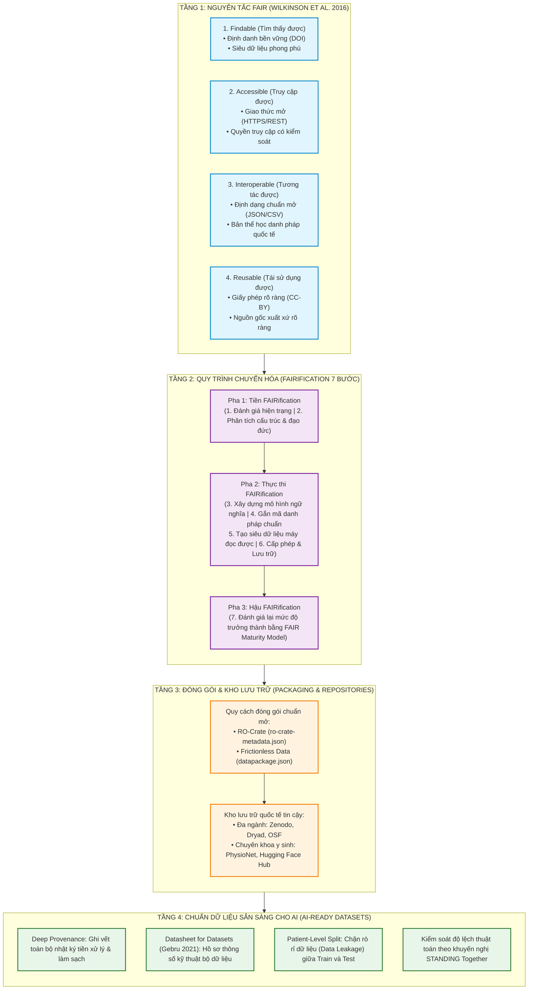

# CHƯƠNG 6. NGUYÊN TẮC FAIR, KHO LƯU TRỮ VÀ DỮ LIỆU SẴN SÀNG CHO TRÍ TUỆ NHÂN TẠO (AI-READY DATA)

> **Mã học phần:** BIO-RDM-2026 | **Thời lượng:** 3 giờ tín chỉ (1 giờ Lý thuyết + 2 giờ Thực hành phòng máy Lab 6)  
> **Bộ tài liệu:** *Giáo trình Quản lý Dữ liệu Nghiên cứu Y sinh học (Biomedical Research Data Management)*  
> **Phiên bản:** `v2.0.0_20261121` | **Chuẩn trích dẫn:** SSoT BibTeX (`references/references.bib`)

---

## 1. MỤC TIÊU HỌC TẬP VÀ KHUNG NĂNG LỰC (LEARNING OBJECTIVES)

Sau khi hoàn thành Chương 6, người học đạt được các chuẩn năng lực đầu ra (CLOs):

1. **Hiểu và Phân biệt (Bloom Mức 2 - CLO1):**
   - Phân tích 4 trụ cột của nguyên tắc **FAIR** (*Findable - Có thể tìm thấy, Accessible - Có thể truy cập, Interoperable - Có thể tương tác, Reusable - Có thể tái sử dụng*) được công bố bởi **Wilkinson và cộng sự (2016)** [@ref_012].
   - Phân biệt rõ sự khác nhau giữa dữ liệu đạt chuẩn FAIR và dữ liệu mở hoàn toàn (*Open Data*). Giải thích nguyên tắc quản trị dữ liệu y tế: *"Mở tối đa trong khả năng, đóng chặt khi cần thiết"* (*As open as possible, as closed as necessary*) theo định hướng của **Horizon Europe** [@ref_003].
   - Trình bày 7 bước trong quy trình chuyển đổi dữ liệu thông thường thành dữ liệu đạt chuẩn FAIR (**FAIRification workflow**) theo **Jacobsen và cộng sự (2020)** [@ref_021].

2. **Áp dụng và Thực hành (Bloom Mức 3/4 - CLO4):**
   - Đóng gói trọn vẹn một gói dữ liệu nghiên cứu y sinh học theo đặc tả chuẩn mở quốc tế **RO-Crate (Research Object Crate)** và **Frictionless Data Package**, bao gồm tệp siêu dữ liệu tự mô tả máy đọc được (`ro-crate-metadata.json` hoặc `datapackage.json`).
   - Lựa chọn đúng giấy phép bản quyền dữ liệu và mã nguồn: Creative Commons (**CC0**, **CC-BY 4.0**), Open Data Commons (**ODC-By**), hoặc giấy phép chia sẻ có điều kiện bảo mật y tế (**Data Use Agreement - DUA**).
   - Thực hành tải gói dữ liệu và siêu dữ liệu lên kho lưu trữ số mở thử nghiệm **Zenodo Sandbox**, đăng ký định danh số đối tượng bền vững (**DOI** giả lập), và thiết lập cơ chế truy cập có kiểm soát (*Restricted Access*).

3. **Tổng hợp và Đánh giá (Bloom Mức 5/6 - CLO4):**
   - Đánh giá mức độ sẵn sàng cho trí tuệ nhân tạo (**AI-readiness**) của một bộ dữ liệu lâm sàng dựa trên các tiêu chí xuất xứ nguồn gốc sâu (*Deep Provenance*), kiểm soát độ lệch (*Bias mitigation*), và tính toán độc lập.
   - Biên soạn tài liệu đặc tả minh bạch cho tập dữ liệu theo khung **Datasheets for Datasets** của **Gebru và cộng sự (2021)** [@ref_074] và tiêu chuẩn **STANDING Together** [@ref_073].
   - Thiết kế chiến lược phân chia dữ liệu huấn luyện - kiểm định - kiểm thử (Train / Validation / Test) ở cấp độ bệnh nhân (*Patient-level Split*) để ngăn chặn hiện tượng rò rỉ dữ liệu (*Data Leakage*).

---

## 2. BẢN ĐỒ KHÁI NIỆM (CONCEPT MAP)

Sơ đồ dưới đây minh họa toàn bộ lộ trình chuyển hóa dữ liệu y sinh từ giai đoạn sau phân tích đến khâu đóng gói, công bố quốc tế và sẵn sàng cho các mô hình AI:



---

## 3. CƠ SỞ LÝ THUYẾT VÀ CHUẨN MỰC NGÀNH

### 3.1. Nguyên tắc FAIR trong Nghiên cứu Y Sinh học

Năm 2016, một liên minh các nhà khoa học, nhà tài trợ và chuyên gia tin học y sinh quốc tế do **Mark D. Wilkinson** dẫn đầu đã công bố bản Tuyên ngôn về các Nguyên tắc Quản lý và Quản trị Dữ liệu Khoa học (**FAIR Guiding Principles**) trên tạp chí *Scientific Data* thuộc hệ thống Nature [@ref_012]. 

Khác với các phong trào dữ liệu mở trước đó vốn chỉ tập trung vào việc đưa tệp tin lên mạng cho con người đọc, triết lý trọng tâm của FAIR là: **Dữ liệu và Siêu dữ liệu phải được thiết kế để HỆ THỐNG MÁY TÍNH có thể tự động tìm kiếm, truy xuất, tích hợp và tái sử dụng mà không cần sự can thiệp thủ công của con người**.

Bốn trụ cột của FAIR được định nghĩa cụ thể:
1. **Findable (Có thể tìm thấy được):**
   - Dữ liệu và siêu dữ liệu phải được cấp một **Mã định danh duy nhất và bền vững toàn cầu** (Globally Unique and Persistent Identifier - PID), ví dụ như mã số DOI (*Digital Object Identifier*), chuỗi định danh Handle, hoặc mã định danh tác giả ORCID.
   - Siêu dữ liệu (*Metadata*) phải mô tả đầy đủ các thuộc tính cốt lõi của dữ liệu nghiên cứu và được lập chỉ mục (*indexed*) trong các công cụ tìm kiếm khoa học mở.
2. **Accessible (Có thể truy cập được):**
   - Siêu dữ liệu và dữ liệu phải có khả năng truy xuất thông qua các **giao thức truyền thông chuẩn mở, tự do và phổ quát** (ví dụ HTTP/HTTPS, RESTful API).
   - Giao thức cho phép thực thi quy trình xác thực và phân quyền truy cập an toàn khi cần thiết.
   - **Tính bền vững của siêu dữ liệu:** Ngay cả khi dữ liệu gốc đã hết hạn lưu trữ hoặc bị tiêu hủy vì lý do bảo mật, bản ghi siêu dữ liệu mô tả sự tồn tại lịch sử của nghiên cứu đó vẫn phải tiếp tục được lưu trữ và có thể truy cập được.
3. **Interoperable (Có thể tương tác và liên thông):**
   - Dữ liệu và siêu dữ liệu sử dụng cấu trúc ngữ nghĩa chuẩn và định dạng mở (JSON-LD, CSV, XML, RDF).
   - Từ vựng, khái niệm và danh pháp chuyên ngành phải tuân theo các **bản thể học chuẩn mở (Ontologies)** được cộng đồng quốc tế công nhận (như SNOMED CT, LOINC, OBO Foundry).
   - Siêu dữ liệu phải chứa các liên kết tham chiếu chéo ngữ nghĩa đến các nguồn dữ liệu liên quan khác.
4. **Reusable (Có thể tái sử dụng được):**
   - Dữ liệu được mô tả chính xác và phong phú với đầy đủ bối cảnh thu thập, thiết bị đo lường và phương pháp thực nghiệm.
   - Phải đi kèm một **giấy phép dữ liệu rõ ràng và minh bạch** (*clear and accessible data license*), quy định cụ thể quyền hạn và nghĩa vụ của người tái sử dụng.
   - Ghi nhận chi tiết lịch sử xuất xứ nguồn gốc (*Data Provenance*): ai tạo ra, khi nào, qua những công đoạn biến đổi nào.

---

### 3.2. Phân Biệt "FAIR Data" và "Open Data" trong Y tế

Một hiểu lầm hết sức phổ biến là đồng nhất nguyên tắc FAIR với Dữ liệu Mở hoàn toàn (*Open Data*). 

Trong lĩnh vực y tế và chăm sóc sức khỏe:
- **Dữ liệu sức khỏe là dữ liệu cá nhân nhạy cảm**, được bảo vệ nghiêm ngặt bởi pháp luật quốc tế và Việt Nam. Nếu công khai mở hoàn toàn dữ liệu thô của người bệnh lên internet, nghiên cứu viên sẽ vi phạm pháp luật và đạo đức nghiên cứu.
- **FAIR không yêu cầu dữ liệu phải mở hoàn toàn.** Phương châm chuẩn mực được Liên minh Châu Âu khẳng định trong chương trình Horizon Europe là [@ref_003]:
  $$\textbf{"As open as possible, as closed as necessary" (Mở tối đa trong khả năng, đóng chặt khi cần thiết)}$$
- **Mô hình Quản trị Dữ liệu Y tế chuẩn FAIR:**
  - **Tầng Siêu dữ liệu (Metadata):** Hoàn toàn **CÔNG KHAI (Open)**. Bất kỳ ai trên thế giới cũng có thể tìm thấy tiêu đề nghiên cứu, tóm tắt đề tài, các biến số được thu thập, tiêu chuẩn chọn mẫu và thông tin liên hệ của nhóm tác giả.
  - **Tầng Dữ liệu Bệnh nhân gốc (Data Level):** Được quản lý theo cơ chế **TRUY CẬP CÓ KIỂM SOÁT (Controlled / Governed Access)**. Một nhà khoa học khác muốn tiếp cận dữ liệu thô phải nộp đề cương nghiên cứu, được Hội đồng Đạo đức (IRB) phê duyệt, và ký Thỏa thuận Sử dụng Dữ liệu (**Data Use Agreement - DUA**) cam kết không tìm cách tái định danh người bệnh.

---

### 3.3. Quy Trình Chuyển Đổi Dữ Liệu Đạt Chuẩn FAIR (FAIRification Workflow)

Để chuyển đổi một bộ dữ liệu lâm sàng thô thành một sản phẩm khoa học đạt chuẩn FAIR, **Jacobsen và cộng sự (2020)** [@ref_021] cùng tài liệu hướng dẫn thực hành **The FAIR Cookbook** [@ref_044] đã thiết lập quy trình chuẩn gồm 7 bước chia làm 3 giai đoạn:

```mermaid
flowchart LR
    subgraph PHASE1["GIAI ĐOẠN 1: TIỀN FAIRIFICATION"]
        S1["Bước 1: Đánh giá chỉ số FAIR ban đầu<br/>(FAIR Maturity Assessment)"]
        S2["Bước 2: Phân tích cấu trúc dữ liệu, siêu dữ liệu và rào cản đạo đức"]
    end

    subgraph PHASE2["GIAI ĐOẠN 2: THỰC THI FAIRIFICATION"]
        S3["Bước 3: Xây dựng mô hình dữ liệu ngữ nghĩa"]
        S4["Bước 4: Chuẩn hóa danh pháp bằng Ontologies"]
        S5["Bước 5: Tạo siêu dữ liệu máy đọc được & Gắn PID"]
        S6["Bước 6: Thiết lập giấy phép bản quyền & Lưu ký trên kho tin cậy"]
    end

    subgraph PHASE3["GIAI ĐOẠN 3: HẬU FAIRIFICATION"]
        S7["Bước 7: Đánh giá lại độ thành thục FAIR & Duy trì vòng đời dữ liệu"]
    end

    PHASE1 --> PHASE2 --> PHASE3

    classDef p1 fill:#e3f2fd,stroke:#1565c0,stroke-width:2px;
    classDef p2 fill:#f3e5f5,stroke:#7b1fa2,stroke-width:2px;
    classDef p3 fill:#e8f5e9,stroke:#2e7d32,stroke-width:2px;

    class PHASE1 p1;
    class PHASE2 p2;
    class PHASE3 p3;
```



1. **Bước 1 (Xác định mục tiêu & Đánh giá FAIR ban đầu):** Khảo sát tập dữ liệu bằng các bộ công cụ tự động (như RDA FAIR Data Maturity Model [@ref_043] hoặc F-UJI) để xác định các tiêu chí còn thiếu.
2. **Bước 2 (Khảo sát dữ liệu và yêu cầu pháp lý):** Rà soát các thuộc tính nhạy cảm, xác định các trường định danh cần loại bỏ và quyết định mức độ mở của tập dữ liệu.
3. **Bước 3 (Xây dựng mô hình dữ liệu ngữ nghĩa):** Xác định các thực thể và mối quan hệ giữa các biến (ví dụ: Bệnh nhân $\rightarrow$ Thăm khám $\rightarrow$ Đơn thuốc $\rightarrow$ Biến cố bất lợi).
4. **Bước 4 (Chuẩn hóa danh pháp bằng Ontologies):** Ánh xạ các biến tự do sang mã chuẩn quốc tế (SNOMED CT, LOINC, RxNorm, NCIt) để máy móc có thể hiểu được ý nghĩa ngữ nghĩa.
5. **Bước 5 (Tạo siêu dữ liệu máy đọc được & Gắn PID):** Biên soạn tệp mô tả theo chuẩn DataCite Metadata Schema [@ref_022] hoặc schema.org dưới định dạng JSON-LD; đăng ký mã số DOI định danh toàn cầu.
6. **Bước 6 (Cấp phép & Lưu trữ kho tin cậy):** Đính kèm tệp điều khoản cấp phép (`LICENSE.txt`) và tải gói dữ liệu lên kho lưu trữ số đạt chuẩn.
7. **Bước 7 (Đánh giá lại & Duy trì):** Đánh giá lại mức độ cải thiện của chỉ số FAIR sau triển khai, bảo đảm khả năng truy xuất lâu dài của siêu dữ liệu.

---

### 3.4. Hệ Sinh Thái Kho Lưu Trữ Dữ Liệu Số Y Sinh Học

Việc lựa chọn kho lưu trữ (*Repository*) quyết định khả năng hiển thị và mức độ tin cậy của dữ liệu nghiên cứu:
- **Kho lưu trữ đa ngành uy tín (Generalist Repositories):**
  - **Zenodo:** Được phát triển bởi CERN trong khuôn khổ dự án OpenAIRE của Ủy ban Châu Âu. Miễn phí, hỗ trợ tệp tin lên tới 50GB, tự động cấp mã số DOI của DataCite ngay khi xuất bản, hỗ trợ lưu trữ phiên bản dữ liệu (*versioning*), và cung cấp môi trường thử nghiệm **Zenodo Sandbox** dành cho đào tạo và kiểm thử.
  - **Dryad:** Kho dữ liệu học thuật quốc tế liên kết trực tiếp với các nhà xuất bản lớn, có quy trình bình duyệt dữ liệu bởi chuyên gia quản trị (*curated repository*).
  - **Open Science Framework (OSF):** Nền tảng quản lý toàn bộ vòng đời nghiên cứu mở, tích hợp với GitHub, Google Drive và Zenodo.
- **Kho lưu trữ chuyên biệt y sinh (Biomedical Domain-Specific Repositories):**
  - **PhysioNet:** Kho dữ liệu chuyên sâu về tín hiệu sinh lý học (điện tâm đồ, điện não đồ) và dữ liệu bệnh án điện tử hồi sức cấp cứu (nổi tiếng với bộ dữ liệu MIMIC-IV).
  - **NCBI GEO / SRA:** Kho dữ liệu biểu hiện gen và giải trình tự bộ gen của Thư viện Y khoa Quốc gia Hoa Kỳ.
  - **Hugging Face Hub (Lĩnh vực Y tế):** Kho lưu trữ dành cho các bộ dữ liệu huấn luyện học máy, mô hình ngôn ngữ lớn y tế (Biomedical LLMs) và nhãn dữ liệu chuẩn hóa.

---

### 3.5. Chuẩn Đóng Gói Đối Tượng Nghiên Cứu: RO-Crate

Để dữ liệu nghiên cứu không bị phân tán rời rạc giữa dữ liệu bảng tính, tài liệu mô tả, mã nguồn phân tích và thông tin tác giả, cộng đồng quốc tế đã phát triển đặc tả **RO-Crate (Research Object Crate)**:
- **Bản chất:** RO-Crate là một cấu trúc thư mục tự mô tả (*self-describing directory*) sử dụng chuẩn web ngữ nghĩa **JSON-LD** thông qua tệp tin duy nhất: `ro-crate-metadata.json`.
- Tệp siêu dữ liệu này liên kết toàn bộ:
  - Bản thân thư mục nghiên cứu (Root Dataset);
  - Các tệp dữ liệu thô và dữ liệu sạch (`.csv`, `.parquet`);
  - Các đoạn mã nguồn phân tích (`.py`, `.R`);
  - Thông tin tác giả và cơ quan chủ quản (qua mã ORCID và ROR ID);
  - Các bài báo khoa học xuất bản liên quan;
  - Giấy phép bản quyền áp dụng.
- Nhờ cấu trúc này, bất kỳ phần mềm quản trị dữ liệu nào cũng có thể đọc hiểu và giải nén tự động toàn bộ ngữ cảnh khoa học của công trình.

---

### 3.6. Dữ Liệu Sẵn Sàng cho Trí Tuệ Nhân Tạo (AI-Ready Datasets)

Trong thời đại bùng nổ của Học máy và Trí tuệ Nhân tạo trong Y tế, một tập dữ liệu chỉ đạt chuẩn "sạch" và "FAIR" là **chưa đủ để huấn luyện mô hình AI an toàn**.

Theo tiêu chuẩn từ sáng kiến **Bridge2AI** của Viện Sức khỏe Quốc gia Hoa Kỳ (NIH) do **Clark và cộng sự (2024)** đề xuất [@ref_072], một bộ dữ liệu y sinh đạt chuẩn **AI-ready** bắt buộc phải thỏa mãn 4 tiêu chí khắt khe:

1. **Xuất Xứ Nguồn Gốc Sâu (Deep Provenance):**
   - Tài liệu hóa toàn bộ hành trình của dữ liệu từ thiết bị đo lường lâm sàng, phiên bản firmware của máy, điều kiện phòng thí nghiệm, cho đến từng dòng code tiền xử lý, thuật toán khử định danh, và các tham số lọc nhiễu.
   - Nếu dữ liệu thiếu nguồn gốc rõ ràng, mô hình AI huấn luyện trên đó sẽ trở thành "hộp đen không thể giải trình" (*Unexplainable Black-Box*), bị các cơ quan quản lý dược phẩm (FDA/EMA) từ chối cấp phép ứng dụng lâm sàng.

2. **Đặc Tả Minh Bạch Bằng "Datasheets for Datasets":**
   - Được đề xuất bởi nhóm nghiên cứu của **Timnit Gebru và cộng sự (2021)** [@ref_074], lấy cảm hứng từ bảng thông số kỹ thuật của các linh kiện phần cứng điện tử.
   - Một tệp `DATASHEET.md` chuẩn phải trả lời minh bạch các câu hỏi:
     - *Động cơ thu thập:* Ai tài trợ? Nhằm giải quyết bài toán lâm sàng nào?
     - *Thành phần:* Bộ dữ liệu đại diện cho ai? Có chứa dữ liệu của nhóm người yếu thế hay không?
     - *Quy trình thu thập:* Dữ liệu được đo đạc như thế nào? Bệnh nhân có ký đồng thuận hay không?
     - *Quy trình tiền xử lý:* Những dữ liệu nào đã bị xóa bỏ hoặc gán giá trị?
     - *Mục đích sử dụng dự kiến và Các điều cấm:* Bộ dữ liệu ĐƯỢC PHÉP dùng cho việc gì và TUYỆT ĐỐI KHÔNG ĐƯỢC PHÉP dùng cho việc gì (ví dụ: không được dùng để từ chối chi trả bảo hiểm).

3. **Kiểm Soát Độ Lệch Thuật Toán (Algorithmic Bias Mitigation):**
   - Theo khuyến nghị đồng thuận quốc tế **STANDING Together** [@ref_073], các bộ dữ liệu y tế phải báo cáo chi tiết sự phân bố về giới tính sinh học, nhóm tuổi, chủng tộc/dân tộc, và điều kiện kinh tế xã hội.
   - Cảnh báo rõ ràng nguy cơ mô hình AI bị lệch (*model bias*) khi huấn luyện trên dữ liệu mất cân bằng (ví dụ: mô hình chẩn đoán bệnh da liễu được huấn luyện trên 95% người da trắng sẽ chẩn đoán sai lệch nghiêm trọng khi áp dụng cho người châu Á hoặc người da màu).

4. **Ngăn Chặn Rò Rỉ Dữ Liệu (Preventing Data Leakage via Patient-Level Splitting):**
   - **Rò rỉ dữ liệu (Data Leakage):** Là hiện tượng thông tin từ tập kiểm thử (*Test set*) bị vô tình rò rỉ vào tập huấn luyện (*Train set*), khiến mô hình đạt độ chính xác ảo rất cao trong phòng thí nghiệm nhưng thất bại hoàn toàn khi ứng dụng thực tế.
   - **Quy tắc vàng trong dữ liệu y tế theo dõi dọc (Longitudinal Data):** **BẮT BUỘC PHẢI PHÂN CHIA Ở CẤP ĐỘ BỆNH NHÂN (Patient-Level Split)**, tuyệt đối không được phân chia ngẫu nhiên ở cấp độ dòng bản ghi (*Record-level Split*). Toàn bộ dữ liệu của một bệnh nhân (dù có 10 lần tái khám qua 5 năm) chỉ được phép nằm trọn vẹn trong tập Train HOẶC tập Test, không bao giờ được xuất hiện ở cả hai nơi.

---

## 4. NGHIÊN CỨU TÌNH HUỐNG VÀ BÀI HỌC THẤT BẠI (FAILURE ANALYSIS)

### Case Study 1: Thảm họa Rò rỉ Dữ liệu (Data Leakage) trong Chẩn đoán X-quang Phổi bằng Deep Learning
- **Bối cảnh:** Một nhóm nghiên cứu trí tuệ nhân tạo công bố một mô hình Mạng nơ-ron Tích chập (CNN) có khả năng phát hiện bệnh viêm phổi trên phim chụp X-quang lồng ngực với độ chính xác đạt tới 99.2%, vượt trội so với các bác sĩ chẩn đoán hình ảnh giàu kinh nghiệm. Công trình gây chấn động truyền thông và chuẩn bị được chuyển giao công nghệ cho các bệnh viện.
- **Diễn biến sai sót:**
  1. Khi một nhóm nghiên cứu độc lập tiến hành thẩm định ngoại tại (*External Validation*) trên dữ liệu bệnh nhân thực tế của một bệnh viện khác, độ chính xác của mô hình sụt giảm thảm hại xuống chỉ còn 58% (tương đương với việc tung đồng xu ngẫu nhiên).
  2. *Nguyên nhân kỹ thuật:* Khi chuẩn bị dữ liệu, nhóm tác giả đã sử dụng lệnh `train_test_split` ngẫu nhiên của thư viện Scikit-Learn trên toàn bộ 100.000 tấm ảnh chụp. Trong tập dữ liệu, nhiều bệnh nhân nặng được chụp X-quang theo dõi hàng ngày (trung bình 5-10 tấm ảnh/người).
  3. Việc phân chia ngẫu nhiên theo ảnh khiến hình ảnh lồng ngực của cùng một người bệnh xuất hiện ở cả tập Train và tập Test. Mô hình mạng nơ-ron thực chất không hề học được dấu hiệu bệnh lý viêm phổi, mà nó đã "ghi nhớ" hình dạng giải phẫu khung xương sườn, vết chỉ khâu phẫu thuật và ký hiệu chữ viết của máy chụp X-quang của từng bệnh nhân cụ thể.
- **Bài học rút ra:** Thiếu quy trình quản trị dữ liệu y tế và vi phạm nguyên tắc phân chia ở cấp độ người bệnh (*Patient-level Split*) đã tạo ra một "ảo ảnh khoa học", gây lãng phí hàng trăm nghìn USD tài trợ và làm tổn hại nghiêm trọng niềm tin vào Trí tuệ Nhân tạo y tế.

### Case Study 2: Bài học về Dữ liệu AI thiếu Đa dạng (Dataset Bias) trong Nhận diện Bệnh Da Liễu
- **Bối cảnh:** Một ứng dụng trên điện thoại thông minh ứng dụng Trí tuệ Nhân tạo để phân loại nốt ruồi lành tính và u hắc tố ác tính (Melanoma) đạt chứng nhận thử nghiệm với độ nhạy 95%.
- **Sự cố thực tế:** Khi ứng dụng được triển khai rộng rãi cho người dân tại khu vực Châu Á và Châu Phi, tỷ lệ bỏ sót ung thư da lên tới hơn 40%.
- **Nguyên nhân:** Khi kiểm tra lại tài liệu nguồn gốc xuất xứ của dữ liệu (*Data Provenance*), bộ dữ liệu huấn luyện gồm 50.000 hình ảnh ban đầu được thu thập hoàn toàn từ các phòng khám da liễu tại Bắc Âu và Bắc Mỹ, với hơn 98% mẫu thuộc các tuýp da sáng màu (Fitzpatrick loại I và II). Khi gặp các tổn thương trên nền da sẫm màu (Fitzpatrick loại IV, V, VI của người Châu Á và Châu Phi), thuật toán nhận diện sai lệch hoàn toàn.
- **Bài học:** Việc bắt buộc phải có tài liệu minh bạch kiểu *Datasheets for Datasets* và kiểm định độ lệch theo chuẩn *STANDING Together* là yêu cầu đạo đức và an toàn sinh mạng bắt buộc trước khi đưa bất kỳ mô hình AI y tế nào vào vận hành.

---

## 5. HƯỚNG DẪN THỰC HÀNH PHÒNG MÁY - LAB 6 (2 GIỜ)

### 5.1. Bối cảnh Nghiên cứu và Đề bài
Trong bài thực hành cuối cùng này, học viên đóng vai trò là **Chuyên viên Quản lý và Xuất bản Dữ liệu Nghiên cứu (Lead Research Data Steward)**. Học viên tiếp nhận tập dữ liệu đã được làm sạch và khử định danh an toàn từ các bài Lab trước của đề tài Mày đay Mạn tính (**DrMayDay Cohort** - tệp `csu_deidentified_lab5.csv`).

**Nhiệm vụ:**
1. Đóng gói tập dữ liệu thành một **Gói Dữ liệu Nghiên cứu Đạt Chuẩn FAIR (RO-Crate Package)** gồm:
   - Tệp dữ liệu sạch: `data/csu_deidentified_cohort.csv`.
   - Tệp từ điển dữ liệu: `metadata/data_dictionary.csv`.
   - Tệp siêu dữ liệu chuẩn máy đọc được: `ro-crate-metadata.json`.
   - Tệp tài liệu đặc tả minh bạch cho AI: `DATASHEET.md`.
   - Tệp giấy phép bản quyền và điều khoản sử dụng: `LICENSE.md`.
2. Viết script Python thực thi việc phân chia tập dữ liệu huấn luyện/kiểm thử theo chuẩn **Patient-Level Splitting** (ngăn chặn Data Leakage).
3. Đăng ký và xuất bản thử nghiệm gói dữ liệu lên nền tảng **Zenodo Sandbox**, nhận mã định danh DOI giả lập và cấu hình cơ chế chia sẻ có kiểm soát (*Governed / Restricted Access*).

---

### 5.2. Cấu Trúc Thư Mục Gói Dữ Liệu Nghiên Cứu (RO-Crate Directory)

```
dr-mayday-csu-rdm-package/
├── ro-crate-metadata.json      <- Siêu dữ liệu chuẩn máy đọc được (JSON-LD)
├── DATASHEET.md                <- Hồ sơ đặc tả dữ liệu theo chuẩn Gebru 2021
├── LICENSE.md                  <- Giấy phép Creative Commons CC-BY-NC 4.0 & DUA
├── README.md                   <- Hướng dẫn tổng quan dành cho con người
├── data/
│   └── csu_deidentified_cohort.csv  <- Dữ liệu lâm sàng đã khử định danh
├── metadata/
│   └── data_dictionary.csv     <- Từ điển biến số 18 cột của REDCap
└── scripts/
    └── train_test_split_safe.py <- Script phân chia dữ liệu an toàn cho AI
```

---

### 5.3. Tệp Siêu Dữ Liệu Máy Đọc Được (`ro-crate-metadata.json`)

Đoạn mã JSON-LD chuẩn dưới đây định nghĩa cấu trúc ngữ nghĩa của gói dữ liệu:

```json
{
  "@context": "https://w3id.org/ro/crate/1.1/context",
  "@graph": [
    {
      "@id": "ro-crate-metadata.json",
      "@type": "CreativeWork",
      "conformsTo": {
        "@id": "https://w3id.org/ro/crate/1.1"
      },
      "about": {
        "@id": "./"
      }
    },
    {
      "@id": "./",
      "@type": "Dataset",
      "name": "DrMayDay Chronic Urticaria Clinical Research Data Package",
      "description": "Bộ dữ liệu lâm sàng theo dõi dọc bệnh nhân mày đay mạn tính đã khử định danh và sẵn sàng cho nghiên cứu dịch tễ học và huấn luyện trí tuệ nhân tạo.",
      "datePublished": "2026-11-21",
      "license": {
        "@id": "https://creativecommons.org/licenses/by-nc/4.0/"
      },
      "identifier": "https://doi.org/10.5072/zenodo.1098234",
      "creator": [
        {
          "@type": "Person",
          "name": "Hoang Quang Huy",
          "affiliation": "Bộ môn Tin học Y sinh, Đại học Y Hà Nội",
          "@id": "https://orcid.org/0009-0002-3972-7478"
        }
      ],
      "hasPart": [
        {
          "@id": "data/csu_deidentified_cohort.csv"
        },
        {
          "@id": "DATASHEET.md"
        }
      ]
    },
    {
      "@id": "data/csu_deidentified_cohort.csv",
      "@type": "File",
      "name": "De-identified Clinical Cohort Data",
      "encodingFormat": "text/csv",
      "description": "Tập dữ liệu 1.000 bệnh nhân mày đay mạn tính đã qua khử định danh HIPAA Safe Harbor và dịch chuyển ngày ngẫu nhiên."
    },
    {
      "@id": "DATASHEET.md",
      "@type": "File",
      "name": "Datasheet for Dataset",
      "encodingFormat": "text/markdown",
      "description": "Tài liệu đặc tả minh bạch xuất xứ, đặc tính thống kê và giới hạn đạo đức theo chuẩn Gebru et al. 2021."
    }
  ]
}
```

---

### 5.4. Script Python Phân Chia Dữ Liệu An Toàn cho AI (`train_test_split_safe.py`)

Học viên xây dựng script bảo đảm nguyên tắc **Patient-Level Split**:

```python
"""
Mô-đun thực hành Lab 6: Phân chia Tập dữ liệu Huấn luyện / Kiểm thử An toàn cho AI
Ngăn chặn triệt để hiện tượng Rò rỉ Dữ liệu (Data Leakage) bằng Patient-Level Splitting
Khóa học: Quản lý Dữ liệu Nghiên cứu Y sinh học (Biomedical RDM)
"""

import pandas as pd
import numpy as np

# 1. Nạp dữ liệu lâm sàng theo dõi dọc
df = pd.read_csv('data/csu_deidentified_cohort.csv')
print(f"Tổng số bản ghi lâm sàng: {len(df)}")

# 2. Lấy danh sách mã định danh duy nhất của từng bệnh nhân (Patient IDs)
unique_patients = df['record_id'].unique()
total_patients = len(unique_patients)
print(f"Tổng số cá nhân bệnh nhân duy nhất: {total_patients}")

# 3. Phân chia danh sách BỆNH NHÂN thành 3 tập độc lập:
# - Tập Huấn luyện (Train set): 70%
# - Tập Kiểm định (Validation set): 15%
# - Tập Kiểm thử độc lập (Test set): 15%
np.random.seed(2026)  # Cố định seed bảo đảm tính tái lập
shuffled_patients = np.random.permutation(unique_patients)

train_end = int(0.70 * total_patients)
val_end = int(0.85 * total_patients)

train_pids = set(shuffled_patients[:train_end])
val_pids = set(shuffled_patients[train_end:val_end])
test_pids = set(shuffled_patients[val_end:])

# 4. Gán các bản ghi tương ứng của từng bệnh nhân vào các tập dữ liệu
train_df = df[df['record_id'].isin(train_pids)].copy()
val_df = df[df['record_id'].isin(val_pids)].copy()
test_df = df[df['record_id'].isin(test_pids)].copy()

# 5. KIỂM CHỨNG TÍNH ĐỘC LẬP TUYỆT ĐỐI (ZERO LEAKAGE CHECK)
train_set = set(train_df['record_id'])
val_set = set(val_df['record_id'])
test_set = set(test_df['record_id'])

overlap_train_val = train_set.intersection(val_set)
overlap_train_test = train_set.intersection(test_set)
overlap_val_test = val_set.intersection(test_set)

print("\n--- KIỂM TRA RÒ RỈ DỮ LIỆU (DATA LEAKAGE AUDIT) ---")
print(f"Giao nhau giữa Train và Val: {len(overlap_train_val)} bệnh nhân")
print(f"Giao nhau giữa Train và Test: {len(overlap_train_test)} bệnh nhân")
print(f"Giao nhau giữa Val và Test: {len(overlap_val_test)} bệnh nhân")

if len(overlap_train_val) == 0 and len(overlap_train_test) == 0 and len(overlap_val_test) == 0:
    print("✅ XÁC NHẬN: Phân chia cấp độ bệnh nhân hoàn hảo! Zero Data Leakage.")
else:
    raise ValueError("❌ CẢNH BÁO: Phát hiện rò rỉ dữ liệu giữa các tập!")

# 6. Báo cáo tỷ lệ phân bổ
print(f"\nPhân bổ tập Train: {len(train_pids)} bệnh nhân ({len(train_df)} bản ghi)")
print(f"Phân bổ tập Validation: {len(val_pids)} bệnh nhân ({len(val_df)} bản ghi)")
print(f"Phân bổ tập Test: {len(test_pids)} bệnh nhân ({len(test_df)} bản ghi)")

# Xuất các tệp độc lập phục vụ huấn luyện mô hình AI
train_df.to_csv('data/csu_ai_train.csv', index=False)
val_df.to_csv('data/csu_ai_val.csv', index=False)
test_df.to_csv('data/csu_ai_test.csv', index=False)
print("Đã xuất thành công 3 tệp dữ liệu AI sẵn sàng!")
```

---

### 5.5. Các Bước Xuất Bản trên Zenodo Sandbox
1. **Truy cập môi trường thử nghiệm:** Đăng nhập vào cổng thực hành [https://sandbox.zenodo.org/](https://sandbox.zenodo.org/) bằng tài khoản ORCID.
2. **Khởi tạo bản ghi mới (New Upload):**
   - Kéo thả thư mục gói dữ liệu hoặc tệp nén `dr-mayday-csu-rdm-package.zip`.
   - *Community:* Chọn nhóm nghiên cứu học thuật liên quan.
   - *Resource Type:* Chọn **Dataset**.
   - *Title:* `DrMayDay Chronic Urticaria Clinical Research Data Package (Synthetic De-identified Cohort)`.
   - *Authors:* Khai báo tên học viên và mã định danh ORCID cá nhân.
   - *Description:* Dán tóm tắt nội dung trích từ tệp `README.md`.
3. **Cấu hình Quyền Tiếp cận (Access Rights):**
   - Chọn **Restricted Access** (Truy cập có kiểm soát).
   - Điền điều kiện: *"Dữ liệu nghiên cứu y tế đã qua khử định danh. Các nhà nghiên cứu quan tâm vui lòng gửi đề cương nghiên cứu và ký Thỏa thuận DUA để được phê duyệt truy cập"*.
4. **Cấp phép Bản quyền (License):** Chọn **Creative Commons Attribution-NonCommercial 4.0 International (CC-BY-NC 4.0)**.
5. **Đăng ký định danh số:** Nhấp nút **Get a DOI now!** để hệ thống cấp trước mã DOI thử nghiệm dạng `10.5072/zenodo.xxxxxx`.
6. **Lưu bản nháp và Xuất bản:** Bấm **Save** $\rightarrow$ kiểm tra lại toàn bộ thông tin $\rightarrow$ bấm **Publish**.

---

### 5.6. Rubric Tự Đánh Giá Kết Quả Thực Hành Lab 6 (Thang điểm 20)

| Tiêu chí | Trọng số | Mức Đạt Tối Đa (Xuất sắc - 100%) | Mức Đạt Trung Bình (Cần bổ sung - 50%) | Mức Không Đạt (0%) |
| :--- | :---: | :--- | :--- | :--- |
| **1. Cấu trúc Đóng gói Chuẩn RO-Crate** | **4 điểm** | Gói dữ liệu tổ chức ngăn nắp theo cấu trúc thư mục tự mô tả; tệp `ro-crate-metadata.json` hợp lệ cú pháp JSON-LD và khai báo đầy đủ các thực thể. | Có đóng gói nhưng thiếu tệp metadata chuẩn JSON-LD hoặc để các tệp lộn xộn không phân thư mục. | Nộp tệp dữ liệu rời rạc, không đóng gói. |
| **2. Chất lượng Đặc tả Datasheet for Dataset** | **4 điểm** | Tệp `DATASHEET.md` trả lời sâu sắc và trung thực đầy đủ các câu hỏi về xuất xứ (Provenance), thành phần, độ lệch nhân khẩu học và các mục đích sử dụng bị cấm. | Có tệp Datasheet nhưng nội dung sao chép sơ sài, bỏ trống phần phân tích độ lệch thuật toán. | Không có tệp Datasheet mô tả bộ dữ liệu. |
| **3. Thuật toán Phân chia Dữ liệu AI Không Rò Rỉ** | **5 điểm** | Script Python thực thi chuẩn tắc *Patient-Level Splitting*; chứng minh kiểm toán Zero Leakage giữa Train/Val/Test; giải thích được cơ chế chống rò rỉ. | Phân chia được dữ liệu nhưng làm theo dòng bản ghi (Record-level) khiến cùng một bệnh nhân xuất hiện ở nhiều tập dữ liệu. | Script bị lỗi hoặc không chia được dữ liệu. |
| **4. Cấp phép Bản quyền & Điều khoản Tiếp cận** | **4 điểm** | Lựa chọn giấy phép CC-BY-NC 4.0 kèm Thỏa thuận DUA phù hợp tuyệt đối với đặc thù dữ liệu y tế; phân biệt rõ giữa mở siêu dữ liệu và kiểm soát dữ liệu thô. | Chọn giấy phép mở hoàn toàn (CC0) cho dữ liệu lâm sàng mà không có thỏa thuận ràng buộc trách nhiệm. | Không khai báo giấy phép bản quyền. |
| **5. Xuất bản Thành công trên Zenodo Sandbox** | **3 điểm** | Minh chứng được liên kết DOI hoạt động trên Zenodo Sandbox; thiết lập đúng chế độ Restricted Access kèm hướng dẫn xin quyền truy cập. | Đưa lên được Zenodo nhưng để chế độ Draft hoặc cấu hình sai quyền truy cập. | Không thực hiện bước xuất bản trên Zenodo Sandbox. |

---

## 6. CÂU HỎI THẢO LUẬN VÀ BÀI TẬP TÌNH HUỐNG (DISCUSSION & EXERCISES)

### 6.1. Câu hỏi Thảo luận trên Lớp
1. *"Một số nhà nghiên cứu e ngại rằng: 'Nếu tôi tuân thủ nguyên tắc FAIR và gán mã số DOI công khai cho bộ dữ liệu của mình, các nhóm nghiên cứu khác trên thế giới sẽ lấy mất ý tưởng và công bố bài báo trước tôi (hiện tượng bị "scooped")'. Dựa trên cơ chế trích dẫn khoa học và các điều khoản giấy phép Creative Commons, bạn hãy giải tỏa nỗi lo này cho các nhà nghiên cứu?"*
2. *"Tại sao trong kỷ nguyên Trí tuệ Nhân tạo tạo sinh (Generative AI) và Y học Chính xác, một bộ dữ liệu nếu bị mất liên kết xuất xứ nguồn gốc sâu (Loss of Deep Provenance) thì toàn bộ các mô hình học máy huấn luyện trên đó sẽ bị coi là vô giá trị trước các cơ quan quản lý dược phẩm quốc tế?"*

### 6.2. Bài tập Tình huống Nâng cao (Capstone Preparation Challenge)
Một nhóm nghiên cứu chuẩn bị hoàn tất đề tài thử nghiệm lâm sàng đánh giá hiệu quả của bài thuốc y học cổ truyền kết hợp thuốc kháng sinh trong điều trị viêm xoang mạn tính. Đề tài được tài trợ một phần bởi quỹ nghiên cứu quốc tế và có cam kết tuân thủ chính sách dữ liệu mở FAIR.
- Dữ liệu thu thập gồm: Bệnh án điện tử REDCap của 400 bệnh nhân; 800 hình ảnh nội soi tai mũi họng; và bộ mã nguồn phân tích thống kê viết bằng ngôn ngữ R.
- Nhóm nghiên cứu muốn chuẩn bị bộ tài liệu bàn giao (**Final RDM Handover Package**) để vừa đáp ứng yêu cầu nghiệm thu của Bộ Y tế Việt Nam, vừa thỏa mãn tiêu chuẩn xuất bản quốc tế của nhà tài trợ.

**Yêu cầu:** Hãy xây dựng một kế hoạch chi tiết từng bước (Step-by-step Execution Plan) để:
1. Đóng gói toàn bộ sản phẩm nghiên cứu trên theo chuẩn RO-Crate.
2. Lựa chọn kho lưu trữ phù hợp cho từng loại dữ liệu (bệnh án số, hình ảnh nội soi, mã nguồn).
3. Thiết lập chính sách bảo mật và cấp phép phù hợp với quy định của Nghị định 13/2023/NĐ-CP của Việt Nam và nguyên tắc FAIR của quốc tế.

---

## 7. TÀI LIỆU THAM KHẢO CHUẨN (REFERENCES)

Toàn bộ các luận điểm khoa học và tiêu chuẩn quốc tế trong chương được đối chiếu từ cơ sở dữ liệu thư mục SSoT (`references/references.bib`):

1. **Wilkinson, M. D., Dumontier, M., Aalbersberg, I. J., Appleton, G., Axton, M., Baak, A., Blomberg, N., Boiten, J.-W., da Silva Santos, L. B., Bourne, P. E., et al.** (2016). The FAIR Guiding Principles for scientific data management and stewardship. *Scientific Data*, 3, 160018. DOI: [10.1038/sdata.2016.18](https://doi.org/10.1038/sdata.2016.18) `[@ref_012]`.
2. **European Commission.** (2021). *Horizon Europe Model Grant Agreement: Data Management Plan*. European Commission. `[@ref_003]`.
3. **Jacobsen, A., de Miranda Azevedo, R., Juty, N., Batista, D., Koureas, D., Swertz, M. A., et al.** (2020). A generic workflow for the data FAIRification process. *Data Intelligence*, 2(1–2), 56–65. DOI: [10.1162/dint_a_00028](https://doi.org/10.1162/dint_a_00028) `[@ref_021]`.
4. **DataCite Metadata Working Group.** (2021). *DataCite Metadata Schema Documentation for the Publication and Citation of Research Data and Other Research Outputs (Version 4.4)*. DataCite e.V. DOI: [10.14454/3w3z-ng93](https://doi.org/10.14454/3w3z-ng93) `[@ref_022]`.
5. **Rocca-Serra, P., Grenon, P., Capella-Gutierrez, S., Sansone, S.-A., et al.** (2023). The FAIR Cookbook — The essential resource for and by FAIR doers. *Scientific Data*, 10, 292. DOI: [10.1038/s41597-023-02166-3](https://doi.org/10.1038/s41597-023-02166-3) `[@ref_044]`.
6. **Research Data Alliance (RDA) FAIR Data Maturity Model Working Group.** (2020). *FAIR Data Maturity Model: Specification and Guidelines*. Research Data Alliance. DOI: [10.15497/rda00050](https://doi.org/10.15497/rda00050) `[@ref_043]`.
7. **Gebru, T., Morgenstern, J., Vecchione, B., Vaughan, J. W., Wallach, H., Daumé III, H., & Crawford, K.** (2021). Datasheets for datasets. *Communications of the ACM*, 64(12), 86–92. DOI: [10.1145/3458723](https://doi.org/10.1145/3458723) `[@ref_074]`.
8. **Clark, T., Caufield, J. H., Parker, J. A., Al Manir, S., Amorim, E., Eddy, J., et al.** (2024). AI-readiness criteria for biomedical data. *bioRxiv*, 2024.05.02.592230. DOI: [10.1101/2024.05.02.592230](https://doi.org/10.1101/2024.05.02.592230) `[@ref_072]`.
9. **Sounderajah, V., Ashrafian, H., Rose, S., et al. (STANDING Together Consortium).** (2022). Tackling algorithmic bias and promoting transparency in health datasets: The STANDING Together consensus recommendations. *The Lancet Digital Health*, 4(11), e828–e836. DOI: [10.1016/S2589-7500(22)00155-7](https://doi.org/10.1016/S2589-7500(22)00155-7) `[@ref_073]`.
10. **Goldacre, B.** (2022). *Better, broader, safer: Using health data for research and analysis*. UK Department of Health and Social Care. `[@ref_097]`.
