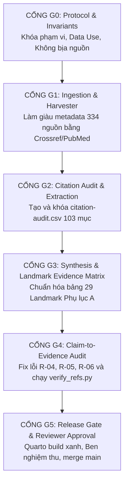

# Kế hoạch tích hợp Pipeline DrMayDay, VERA và REview để hoàn thiện Literature Review (Biomedical RDM)

**Phiên bản:** 1.0.0  
**Ngày lập:** 21/11/2026  
**Đơn vị thực hiện:** Biên tập viên (chủ trì rà soát & biên soạn)  
**Đơn vị kiểm tra/Thực thi kỹ thuật:** Kỹ thuật viên / script tự động  
**Người nghiệm thu:** TS. Hoàng Quang Huy (Ben)  
**Mục tiêu áp dụng:** Repository `fossbk-spec/biomedical-rdm` (Nhánh `feat/initial-rdm-project`)  

---

## 1. BỐI CẢNH & MỤC TIÊU

Tài liệu Literature Review hiện tại của dự án (`docs/literature-review/index.md` và `references/`) đã có khối lượng nghiên cứu đồ sộ (~150KB tổng quan y văn, 334 nguồn danh mục master, 103 trích dẫn thân bài, 29 tài liệu Landmark Phụ lục A). 

Tuy nhiên, bản review độc lập (`RDM_PR_Review_v1.0.0_20261120.md`) đã chỉ ra các rủi ro học thuật cần xử lý dứt điểm trước khi merge:
- **R-01 & R-03:** Thiếu file audit đối soát trạng thái 103 trích dẫn (`references/citation-audit.csv`), mâu thuẫn giữa tuyên bố "chỉ trích dẫn mục đã kiểm chứng" với việc vẫn trích dẫn 9-12 mục pending.
- **R-04:** Bằng chứng cho mốc phát hành FHIR R6 và ICH E6(R3) Annex 2 chưa gắn đúng tài liệu nguồn.
- **R-05:** Nguồn số liệu OHDSI bị lẫn lộn giữa *Our Journey* (10/2025) và *Year in Review* (12/2025).
- **R-06:** Thông tin mẫu DMSP theo NIH NOT-OD-26-046 cần chuẩn hóa.
- **R-08:** Rà soát khung pháp lý y tế Việt Nam (Luật KCB 2023, Nghị định 13/2023/NĐ-CP).

**Mục tiêu:** Áp dụng toàn diện 3 hạ tầng đã trưởng thành từ hệ sinh thái:
1. **Từ `DrMayDay` (Module `evisyn`):** Khung thu hoạch siêu dữ liệu (Harvester) và Ma trận Bằng chứng (Evidence Matrix).
2. **Từ `VERA-DrMayDay`:** Quy trình 6 cổng chất lượng (G0–G5), Claim-to-Evidence Audit, và cơ chế phân loại trạng thái trích dẫn (`VERIFIED`, `BIB_PENDING`, `CONTENT_PENDING`, `BLOCKED_INPUT`).
3. **Từ `Academic_Peer_Review`:** Chuẩn mực thẩm định PRISMA 2020 và đối soát tính chuẩn xác pháp lý y sinh.

---

## 2. QUY TRÌNH 6 CỔNG KIỂM SOÁT VERA ÁP DỤNG CHO RDM (G0 – G5)



### Cổng G0: Thiết lập Protocol & Ranh giới bất biến (Invariants)
- **Quy tắc bất biến 1 (Zero-Hallucination):** Tuyệt đối không tự suy đoán thông tin thư mục hoặc mốc thời gian thiếu. Nếu thiếu, ghi nhận trạng thái `BIB_PENDING` hoặc `CONTENT_PENDING`.
- **Quy tắc bất biến 2 (Bảo vệ dữ liệu):** Tuân thủ tuyệt đối `docs/DATA-USE.md`, không đưa dữ liệu bệnh nhân thực, mã khóa bí mật hoặc định danh cá nhân vào repo.

### Cổng G1: Thu hoạch & Làm giàu danh mục thư mục (Ingestion)
- Sử dụng logic Harvester của `DrMayDay` để chạy script làm giàu metadata tự động cho `references/references-334.bib` từ `references/source-334-list.md`:
  - Truy vấn tự động qua Crossref API và PubMed API dựa trên DOI và PMID.
  - Điền các trường còn khuyết: `author`, `journal`, `year`, `volume`, `number`, `pages`.
  - Tạo `references/search-log.csv` ghi nhận thời điểm truy vấn API.

### Cổng G2: Hoàn thiện Bảng đối soát trích dẫn (`citation-audit.csv`)
- Khởi tạo và hoàn thiện `references/citation-audit.csv` đủ 103 dòng (tương ứng 103 trích dẫn trong thân bài) với cấu trúc:
  ```csv
  source_number,citation_key,status,missing_field,used_in,action
  ```
- **Quy tắc phân loại trạng thái:**
  - `VERIFIED`: Đã đối soát chính xác cả nội dung khẳng định và trường thư mục.
  - `BIB_PENDING`: Mệnh đề nội dung đúng nhưng BibTeX còn thiếu trường chi tiết (vd: số trang/volume).
  - `CONTENT_PENDING`: Mệnh đề hoặc căn cứ thời gian/số liệu cần đối soát thêm.
  - `BLOCKED_INPUT`: Nguồn gốc chưa được cung cấp.

### Cổng G3: Ma trận Bằng chứng Phụ lục A (Evidence Matrix)
- Áp dụng cấu trúc `evisyn/synthesis` để chuẩn hóa bảng Phụ lục A:
  - Giữ cố định 29 tài liệu Landmark đã xác minh đầy đủ.
  - Tạm thời loại Dayan [89] ra khỏi danh sách Landmark cho đến khi xác minh xong metadata (ghi chú rõ lý do trong `docs/DECISIONS.md`).
  - Mỗi mục Landmark gồm: `[STT, Tác giả/Năm, Tiêu đề, Vấn đề cốt lõi RDM, Đóng góp phương pháp, Trạng thái Audit]`.

### Cổng G4: Claim-to-Evidence Audit (Sửa dứt điểm 4 lỗi nội dung)
1. **Sửa R-03 (Minh bạch trích dẫn Pending):**
   - Trong `docs/literature-review/index.md`, sửa câu mở đầu: *"Bài viết trích dẫn các tài liệu đã được thẩm định; các mục còn trong quá trình xác minh metadata được gắn nhãn cảnh báo rõ ràng"*.
   - Rà soát đồng bộ: Gắn cờ hiển thị cho các mục `[1]`, `[2]`, `[3]`, `[89]` và cập nhật con số thống kê chính xác ở `docs/DECISIONS.md`.
2. **Sửa R-04 (Mốc thời gian FHIR R6 & ICH E6(R3)):**
   - **FHIR R6:** Đổi trích dẫn từ trang ví dụ `valueset-example-...` sang trang *HL7 FHIR Roadmap / Publication Schedule*. Ghi rõ: *"FHIR R6 hiện là dự thảo đang trong các chu kỳ ballot, chưa ban hành chính thức"*.
   - **ICH E6(R3):** Trích dẫn bản Guideline Step 4 chính thức (06/01/2025). Với Annex 2, nêu rõ là hợp phần đang hoàn thiện theo lộ trình điều phối quốc tế.
3. **Sửa R-05 (Thống nhất nguồn số liệu OHDSI):**
   - Phân định rõ 2 tài liệu: Báo cáo cộng đồng *Our Journey: 5th Edition* (tháng 10/2025, URL `.../OurJourney-2025.pdf`) và Báo cáo thường niên *Year in Review* (tháng 12/2025).
   - Chuẩn hóa câu văn trong thân bài và Phụ lục B để không mâu thuẫn mốc thời gian.
4. **Sửa R-06 (NIH DMSP NOT-OD-26-046):**
   - Xác minh số hiệu thông tri trên NIH Guide for Grants and Contracts; chuẩn hóa câu văn khẳng định đây là thông tri hướng dẫn áp dụng cho các đề xuất tài trợ mới.
5. **Rà soát R-08 (Khung pháp lý Việt Nam theo chuẩn Academic_Peer_Review):**
   - Bổ sung đối chiếu ngắn gọn với *Luật Khám bệnh, chữa bệnh số 15/2023/QH15* (quy định lưu trữ hồ sơ bệnh án) và *Nghị định 13/2023/NĐ-CP* (phân loại dữ liệu sức khỏe là dữ liệu cá nhân nhạy cảm, yêu cầu Đánh giá tác động xử lý dữ liệu - DPIA).

### Cổng G5: Nghiệm thu & Biên dịch Release Candidate
- Chạy toàn bộ test suite kiểm tra:
  ```bash
  python scripts/verify_refs.py
  quarto render docs/literature-review/index.md
  ```
- Kết quả bắt buộc:
  - `verify_refs.py` trả về mã thoát `0` (Không có citekey mồ côi, không lỗi parse BibTeX).
  - Quarto render ra HTML sạch, mục lục, bảng biểu và danh mục tham khảo hiển thị đầy đủ, không có cảnh báo citeproc thiếu nguồn.
- Gửi báo cáo hoàn thành cho TS. Hoàng Quang Huy (Ben) phê duyệt để merge PR #1.

---

## 3. PHÂN CÔNG NHIỆM VỤ CHI TIẾT (ACTION ITEMS)

### Nhiệm vụ dành cho biên tập viên (Biên soạn & Thẩm định nội dung):
1. **Rà soát và vá nội dung `docs/literature-review/index.md`:**
   - Cập nhật các đoạn văn bản liên quan đến lỗi R-03, R-04, R-05, R-06, R-08.
   - Đồng bộ hóa các ghi chú `[CẦN KIỂM CHỨNG]` trong văn bản với `citation-audit.csv`.
2. **Cập nhật hồ sơ quản trị:**
   - Ghi nhật ký các thay đổi vào `docs/literature-review/CHANGES.md`.
   - Cập nhật các quyết định học thuật mới vào `docs/DECISIONS.md`.

### Nhiệm vụ dành cho Kỹ thuật viên / script tự động (Hạ tầng kỹ thuật):
1. **Hoàn thiện bộ script:**
   - Nâng cấp `scripts/verify_refs.py` để kiểm tra chéo tự động giữa `citation-audit.csv`, `references.bib` và `index.md`.
   - Xây dựng script `scripts/harvest_metadata.py` hỗ trợ truy vấn bổ sung DOI/PMID thiếu.
2. **Biên dịch & Kiểm định:**
   - Chạy `quarto render` kiểm thử trên local, đảm bảo trang web tĩnh `_site/` build trơn tru.

---

## 4. TIÊU CHÍ NGHIỆM THU (ACCEPTANCE CRITERIA)

- [ ] **AC-1:** File `references/citation-audit.csv` tồn tại với đủ 103 dòng, không còn trích dẫn nào ở trạng thái mơ hồ.
- [ ] **AC-2:** File `docs/literature-review/index.md` đã sửa triệt để 4 điểm cảnh báo thời gian/nguồn (FHIR, ICH, OHDSI, NIH).
- [ ] **AC-3:** Khung pháp lý Việt Nam (NĐ 13/2023, Luật KCB 2023) được tích hợp chính xác và chuẩn mực.
- [ ] **AC-4:** Script `python scripts/verify_refs.py` chạy thành công không cảnh báo lỗi.
- [ ] **AC-5:** Lệnh `quarto render` biên dịch tài liệu sang HTML thành công mà không phát sinh lỗi trích dẫn citeproc.
- [ ] **AC-6:** Nhật ký thay đổi `CHANGES.md` và `DECISIONS.md` được cập nhật đầy đủ có dấu vết.
