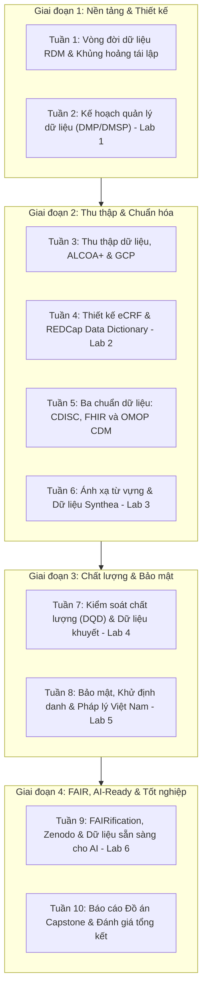

# ĐỀ CƯƠNG CHI TIẾT HỌC PHẦN
## QUẢN LÝ DỮ LIỆU NGHIÊN CỨU Y SINH (BIOMEDICAL RDM)

| Thuộc tính | Chi tiết |
|---|---|
| **Mã học phần dự kiến** | BME-3040 / CS-4080 |
| **Tên tiếng Việt** | Quản lý dữ liệu nghiên cứu y sinh |
| **Tên tiếng Anh** | Biomedical Research Data Management (BioRDM) |
| **Phiên bản đề cương** | **v2.0.0_20261121** |
| **Ngày ban hành / cập nhật** | 21/11/2026 |
| **Khối lượng học tập** | 2 tín chỉ (30 giờ chuẩn: 18 giờ Lý thuyết + 12 giờ Thực hành phòng máy / Seminar) |
| **Chủ nhiệm học phần / Tác giả** | TS. Hoàng Quang Huy (Đại học Bách khoa Hà Nội) |
| **Khoa / Viện phụ trách** | Trường Điện - Điện tử / Nhóm Nghiên cứu Kỹ thuật Y sinh (BME) |
| **Đối tượng người học** | Sinh viên năm 3–4 Kỹ thuật Y sinh, Công nghệ Thông tin Y tế, Khoa học Dữ liệu; Bác sĩ nội trú, Học viên Cao học / NCS Y Dược; Điều phối viên nghiên cứu lâm sàng (CRC/CRA). |
| **Học phần học trước / Tiên quyết** | Thống kê sinh học cơ bản, Tin học đại cương hoặc Cơ sở dữ liệu y tế |
| **Tài liệu nền tảng SSoT** | `fossbk-spec/biomedical-rdm` (103 nguồn trích dẫn đã qua audit y văn, 29 tài liệu Landmark) |

---

## 1. MỤC TIÊU VÀ MÔ TẢ HỌC PHẦN

### 1.1. Mô tả học phần
Học phần cung cấp kiến thức nền tảng và kỹ năng thực chiến chuyên sâu về **Quản lý dữ liệu nghiên cứu y sinh (Biomedical Research Data Management - BioRDM)** xuyên suốt 7 giai đoạn của vòng đời nghiên cứu: từ thiết kế Kế hoạch quản lý dữ liệu (DMP), thu thập dữ liệu lâm sàng theo chuẩn ALCOA+ và GCP, thiết kế biểu mẫu thu thập điện tử (eCRF trên REDCap), chuẩn hóa dữ liệu theo các tiêu chuẩn quốc tế (CDISC SDTM, HL7 FHIR, OMOP CDM), đánh giá chất lượng dữ liệu (Data Quality Dashboard), xử lý dữ liệu khuyết và khử định danh bảo vệ quyền riêng tư (HIPAA Safe Harbor, Nghị định 13/2023/NĐ-CP, Luật Khám bệnh, chữa bệnh 2023), cho đến chia sẻ dữ liệu nghiên cứu đạt chuẩn FAIR và chuẩn bị dữ liệu sẵn sàng cho trí tuệ nhân tạo (AI-ready).

### 1.2. Mục tiêu học phần (Course Goals)
Trang bị cho người học tư duy quản trị dữ liệu chủ động: *"Quyết định càng sớm càng rẻ; DMP là bản hợp đồng dữ liệu của cả nghiên cứu, không phải thủ tục hành chính"*, hình thành năng lực thiết kế hệ thống dữ liệu y sinh có khả năng tái lập, tương tác liên thông và tuân thủ chặt chẽ đạo đức y học.

---

## 2. CHUẨN ĐẦU RA HỌC PHẦN (COURSE LEARNING OUTCOMES - CLO)

Sau khi hoàn thành học phần, người học có năng lực:

| Mã CLO | Chuẩn đầu ra học phần | Thang đo Bloom | Hoạt động dạy & học | Phương pháp đánh giá |
| :--- | :--- | :--- | :--- | :--- |
| **CLO1** | **Giải thích** được vòng đời 7 giai đoạn của dữ liệu y sinh, nguyên tắc ALCOA+, nguyên tắc FAIR, và sự khác biệt về vai trò giữa các chuẩn dữ liệu CDISC, HL7 FHIR, OMOP CDM. | **Mức 2 (Hiểu)** | Thuyết giảng, đọc tài liệu Landmark, seminar tình huống | Trắc nghiệm củng cố (Quiz 1–6), Đánh giá chuyên cần |
| **CLO2** | **Xây dựng** được Kế hoạch quản lý dữ liệu (DMP) đạt chuẩn NIH/Horizon Europe; **Thiết kế** được biểu mẫu thu thập dữ liệu điện tử (eCRF) và Từ điển dữ liệu (Data Dictionary) trên hệ thống REDCap. | **Mức 3 (Áp dụng)** | Hướng dẫn phòng máy, thực hành DMPTool, tạo dự án REDCap | Bài tập Lab 1, Lab 2; Đồ án môn học |
| **CLO3** | **Đánh giá** chất lượng dữ liệu y tế (Data Quality Dashboard), phân tích cơ chế dữ liệu khuyết (MCAR, MAR, MNAR); **Áp dụng** các kỹ thuật khử định danh (De-identification) tuân thủ HIPAA và Nghị định 13/2023/NĐ-CP. | **Mức 4 (Phân tích)** | Thảo luận ca lỗi dữ liệu, chạy script Python/R kiểm thử chất lượng và khử định danh | Bài tập Lab 3, Lab 4, Lab 5; Đồ án môn học |
| **CLO4** | **Tích hợp & Đóng gói** bộ dữ liệu nghiên cứu y sinh đạt chuẩn FAIR, cấp định danh số (DOI/Zenodo), thiết lập điều khoản cấp phép chia sẻ và chuẩn bị dữ liệu sẵn sàng cho AI (AI-ready). | **Mức 5/6 (Tổng hợp & Đánh giá)** | Hướng dẫn đóng gói RO-Crate/Zenodo Sandbox, phản biện đồ án | Bài tập Lab 6; Báo cáo Đồ án Capstone cuối kỳ |

---

## 3. PHƯƠNG PHÁP & MA TRẬN ĐÁNH GIÁ (ASSESSMENT SCHEME)

Kết quả học tập được đánh giá kết hợp giữa quá trình và sản phẩm cuối khóa:

```
Tổng điểm học phần (100%) = Đánh giá quá trình (15%) + Bài thực hành phòng máy (35%) + Đồ án Capstone (50%)
```

| Thành phần | Hình thức đánh giá | Tiêu chí / Nội dung đánh giá | Trọng số | Chuẩn CLO |
| :--- | :--- | :--- | :--- | :--- |
| **A1. Đánh giá quá trình** | Chuyên cần & Quizzes | Tham gia thảo luận trên lớp; hoàn thành 6 bài quiz trắc nghiệm ngắn (4 câu/bài) sau mỗi module lý thuyết. | **15%** | CLO1 |
| **A2. Thực hành phòng máy (Labs)** | 5 Báo cáo thực hành cá nhân/nhóm | - Lab 1: Soạn DMP trên DMPTool (7%)<br/>- Lab 2: Thiết kế dự án REDCap (7%)<br/>- Lab 3: Thao tác dữ liệu Synthea FHIR/OMOP (7%)<br/>- Lab 4: Đánh giá chất lượng dữ liệu DQD (7%)<br/>- Lab 5: Khử định danh dữ liệu Python/R (7%) | **35%** | CLO2, CLO3 |
| **A3. Đồ án môn học (Capstone)** | Báo cáo hồ sơ RDM trọn gói & Thuyết trình | Xây dựng trọn bộ **RDM Package** cho một bài toán nghiên cứu y sinh giả định: DMP + Dự án REDCap + Báo cáo chất lượng & khử định danh + Gói dữ liệu FAIR trên Zenodo Sandbox + Bài thuyết trình nhóm. | **50%** | CLO2, CLO3, CLO4 |

---

## 4. KẾ HOẠCH GIẢNG DẠY CHI TIẾT (10 TUẦN / 30 GIỜ CHUẨN)



---

### TUẦN 1: TỔNG QUAN RDM VÀ VÒNG ĐỜI DỮ LIỆU Y SINH
* **Nội dung lý thuyết (2h):**
  - Khủng hoảng khả năng tái lập trong khoa học y sinh; vai trò sống còn của RDM.
  - Vòng đời 7 giai đoạn của dữ liệu y sinh: *Thiết kế $\rightarrow$ Thu thập $\rightarrow$ Làm sạch $\rightarrow$ Chuẩn hóa $\rightarrow$ FAIR/Chia sẻ $\rightarrow$ Bảo mật/Pháp lý $\rightarrow$ Lưu trữ/Hủy*.
  - Phân định ranh giới giữa: **Protocol** (nghiên cứu làm gì), **DMP** (dữ liệu là gì, lưu ở đâu, chia sẻ thế nào), và **CRF** (thu thập từng trường cụ thể).
  - Phân tích ca thất bại kinh điển: Mất mát dữ liệu sau công bố và rủi ro gian lận nghiên cứu.
* **Tự học & Đọc trước:**
  - Đọc tài liệu Landmark: Wilkinson et al. (2016) về nguyên tắc FAIR (*Sci Data*, DOI: 10.1038/sdata.2016.18).
  - Hoàn thành **Quiz 1** trên hệ thống học tập.

---

### TUẦN 2: THIẾT KẾ KẾ HOẠCH QUẢN LÝ VÀ CHIA SẺ DỮ LIỆU (DMP/DMSP)
* **Nội dung lý thuyết (1h):**
  - Yêu cầu chính sách của các nhà tài trợ quốc tế: NIH Data Management and Sharing Policy (DMSP 2023, mẫu tinh giản 2026 theo NOT-OD-26-046), Horizon Europe.
  - 6 thành tố cốt lõi của một bản DMSP: Loại dữ liệu, công cụ/phần mềm, chuẩn dữ liệu, bảo tồn/chia sẻ, hạn chế tiếp cận, giám sát tuân thủ.
  - Vòng đời của DMP: Dự thảo $\rightarrow$ Thẩm định $\rightarrow$ Rà soát định kỳ $\rightarrow$ Đóng băng khi kết thúc dự án.
* **Thực hành phòng máy - Lab 1 (2h):**
  - **Tên bài thực hành:** *Soạn thảo Kế hoạch Quản lý Dữ liệu trên nền tảng DMPTool*.
  - **Nhiệm vụ:** Đăng nhập DMPTool, chọn mẫu NIH DMSP, viết hoàn chỉnh bản DMSP $\le 2$ trang cho một nghiên cứu thử nghiệm lâm sàng hoặc nghiên cứu dịch tễ giả định.
* **Thảo luận tình huống:** *"Dự toán ngân sách cho RDM trong hồ sơ xin tài trợ nghiên cứu: bao nhiêu là hợp lý và được chấp nhận?"*

---

### TUẦN 3: THU THẬP DỮ LIỆU LÂM SÀNG, ALCOA+ VÀ GCP
* **Nội dung lý thuyết (2h):**
  - Tiêu chuẩn toàn vẹn dữ liệu: Nguyên tắc **ALCOA+** (*Attributable, Legible, Contemporaneous, Original, Accurate + Complete, Consistent, Enduring, Available*).
  - Thực hành lâm sàng tốt (ICH E6 GCP) và Tiêu chuẩn FDA 21 CFR Part 11 về hệ thống máy tính, chữ ký điện tử và vết kiểm toán (Audit Trail).
  - So sánh rủi ro: Quản lý dữ liệu bằng bảng tính (Excel/Google Sheets) vs Hệ thống thu thập dữ liệu lâm sàng điện tử chuyên dụng (EDC).
* **Tự học & Đọc trước:**
  - Hoàn thành **Quiz 2** (Thu thập dữ liệu, EDC & ALCOA+).

---

### TUẦN 4: THIẾT KẾ eCRF VÀ TỪ ĐIỂN DỮ LIỆU TRÊN REDCap
* **Nội dung lý thuyết (1h):**
  - Nguyên tắc thiết kế biểu mẫu thu thập dữ liệu điện tử (eCRF): Cấu trúc biến, kiểu dữ liệu, ràng buộc giá trị hợp lệ (range checks), logic rẽ nhánh (branching logic).
  - Khái niệm Common Data Elements (CDEs) của NIH/NCI. Tầm quan trọng của Siêu dữ liệu (Metadata) và Từ điển dữ liệu (Data Dictionary).
* **Thực hành phòng máy - Lab 2 (2h):**
  - **Tên bài thực hành:** *Thiết kế dự án eCRF và Data Dictionary trên REDCap*.
  - **Nhiệm vụ:** Xây dựng dự án nghiên cứu trên REDCap gồm tối thiểu 3 công cụ (Forms): Thông tin nhân khẩu học, Chỉ số sinh tồn lâm sàng (có kiểm tra khoảng đo hợp lý), và Biến cố bất lợi (AE). Xuất và chỉnh sửa Data Dictionary (.csv), cấu hình phân quyền người dùng (User Rights).

---

### TUẦN 5: CHUẨN HÓA DỮ LIỆU Y TẾ: CDISC, HL7 FHIR VÀ OMOP CDM
* **Nội dung lý thuyết (2h):**
  - **CDISC (SDTM / ADaM):** Chuẩn nộp hồ sơ thử nghiệm lâm sàng bắt buộc của FDA/PMDA.
  - **HL7 FHIR:** Chuẩn thế hệ mới trao đổi dữ liệu bệnh viện/EHR (RESTful API, Resources, JSON/XML).
  - **OMOP Common Data Model (OHDSI):** Chuẩn hóa dữ liệu quan sát và nghiên cứu thế giới thực (RWD/RWE).
  - Ma trận so sánh 3 chuẩn: Mục đích sử dụng, ưu điểm, hạn chế và tính bổ trợ lẫn nhau (không thay thế nhau).
* **Tự học & Đọc trước:**
  - Hoàn thành **Quiz 3** (Các chuẩn dữ liệu y tế quốc tế).

---

### TUẦN 6: ÁNH XẠ TỪ VỰNG Y TẾ VÀ XỬ LÝ DỮ LIỆU MẪU (SYNTHEA)
* **Nội dung lý thuyết (1h):**
  - Các hệ thống phân loại và thuật ngữ y tế chuẩn hóa: SNOMED CT (lâm sàng), LOINC (xét nghiệm), RxNorm (thuốc), ICD-10 (chẩn đoán). Quy trình ánh xạ từ vựng (Vocabulary Mapping).
* **Thực hành phòng máy - Lab 3 (2h):**
  - **Tên bài thực hành:** *Khám phá dữ liệu bệnh nhân tổng hợp Synthea qua lăng kính FHIR và OMOP*.
  - **Nhiệm vụ:** Đọc tập dữ liệu bệnh nhân tổng hợp Synthea; truy vấn các trường dữ liệu theo tài nguyên FHIR `Patient`, `Observation`, `Condition`; đối chiếu cấu trúc với các bảng `person`, `condition_occurrence`, `measurement` trong OMOP CDM.

---

### TUẦN 7: KIỂM SOÁT CHẤT LƯỢNG DỮ LIỆU, DỮ LIỆU KHUYẾT VÀ TÁI LẬP
* **Nội dung lý thuyết (1h):**
  - Khung kiểm tra chất lượng dữ liệu của Kahn et al. (2016): Tính hợp chuẩn (Conformance), Tính đầy đủ (Completeness), Tính hợp lý (Plausibility).
  - Cơ chế dữ liệu khuyết: MCAR (Khuyết hoàn toàn ngẫu nhiên), MAR (Khuyết ngẫu nhiên), MNAR (Khuyết không ngẫu nhiên). Rủi ro sai lệch khi tùy tiện xóa bỏ dòng khuyết.
  - Tổng quan công cụ mã nguồn mở OHDSI Data Quality Dashboard (DQD).
* **Thực hành phòng máy - Lab 4 (2h):**
  - **Tên bài thực hành:** *Đánh giá chất lượng dữ liệu lâm sàng với OHDSI DQD*.
  - **Nhiệm vụ:** Chạy script đánh giá chất lượng trên một tập dữ liệu lâm sàng mẫu; phân tích báo cáo lỗi, lập danh sách các trường dữ liệu vi phạm tính hợp chuẩn/hợp lý và đề xuất phương án làm sạch.
* **Tự học:** Hoàn thành **Quiz 4** (Chất lượng dữ liệu & Dữ liệu khuyết).

---

### TUẦN 8: BẢO MẬT DỮ LIỆU, KHỬ ĐỊNH DANH VÀ PHÁP LÝ Y TẾ VIỆT NAM
* **Nội dung lý thuyết (1h):**
  - Khung bảo mật quốc tế: Tiêu chuẩn HIPAA (Safe Harbor với 18 định danh vs Expert Determination); Quy định bảo vệ dữ liệu chung châu Âu (GDPR).
  - **Khung pháp lý Việt Nam:** *Luật Khám bệnh, chữa bệnh số 15/2023/QH15* (quy định hồ sơ bệnh án và tính bảo mật); *Nghị định 13/2023/NĐ-CP* (phân loại dữ liệu sức khỏe là dữ liệu cá nhân nhạy cảm, yêu cầu lập Hồ sơ đánh giá tác động xử lý dữ liệu cá nhân - DPIA); Thông tư 46/2018/TT-BYT (bệnh án điện tử).
  - Đạo đức nghiên cứu y sinh và vai trò của Hội đồng đạo đức (IRB/IEC).
* **Thực hành phòng máy - Lab 5 (2h):**
  - **Tên bài thực hành:** *Khử định danh tập dữ liệu lâm sàng (De-identification Pipeline)*.
  - **Nhiệm vụ:** Viết script Python/R loại bỏ 18 định danh cá nhân trực tiếp, thực hiện che giấu độ tuổi $> 89$, và áp dụng thuật toán dịch chuyển mốc ngày tháng ngẫu nhiên theo từng bệnh nhân (Date Shifting) để bảo toàn khoảng cách thời gian giữa các biến cố lâm sàng.
* **Tự học:** Hoàn thành **Quiz 5** (Bảo mật & Pháp lý y tế).

---

### TUẦN 9: NGUYÊN TẮC FAIR, KHO LƯU TRỮ VÀ DỮ LIỆU SẴN SÀNG CHO AI
* **Nội dung lý thuyết (1h):**
  - Quy trình FAIRification: Cấp định danh cố định (PID: DOI, ORCID, ROR), gắn siêu dữ liệu chuẩn hóa máy đọc được (Machine-actionable Metadata).
  - So sánh các kho lưu trữ dữ liệu y sinh: Zenodo, Dryad, PhysioNet, Hugging Face Hub (y tế). Các điều khoản giấy phép dữ liệu: Creative Commons (CC0, CC-BY), Open Data Commons (ODC-By).
  - Bộ dữ liệu sẵn sàng cho trí tuệ nhân tạo (AI-ready Datasets): Tài liệu hóa theo chuẩn *Datasheets for Datasets* (Gebru et al.), phân chia độc lập tập Train/Validation/Test, kiểm soát độ lệch thuật toán và nhãn chuyên khoa chuẩn.
* **Thực hành phòng máy - Lab 6 (2h):**
  - **Tên bài thực hành:** *Đóng gói và xuất bản bộ dữ liệu nghiên cứu FAIR trên Zenodo Sandbox*.
  - **Nhiệm vụ:** Đóng gói thư mục dữ liệu sạch theo chuẩn Frictionless Data Package / RO-Crate (`datapackage.json`, `README.md`, `LICENSE`), tải lên môi trường thử nghiệm Zenodo Sandbox, đăng ký DOI giả lập và cấu hình quyền truy cập mở có kiểm soát.
* **Tự học:** Hoàn thành **Quiz 6** (FAIR & Dữ liệu sẵn sàng cho AI).

---

### TUẦN 10: BÁO CÁO ĐỒ ÁN CAPSTONE VÀ ĐÁNH GIÁ TỔNG KẾT
* **Seminar & Phản biện đồ án (2h):**
  - Các nhóm sinh viên thuyết trình và phản biện sản phẩm **RDM Package** trước hội đồng.
  - Phân tích tình huống phản biện: Khắc phục sự cố khi nhà tài trợ hoặc tạp chí yêu cầu giải trình dữ liệu sau công bố.
* **Đánh giá tổng kết (1h):**
  - Làm bài kiểm tra tổng hợp cuối khóa (**Comprehensive Workflow Assessment** - 10 câu hỏi kịch bản tình huống tích hợp, thời gian 30 phút).
  - Tổng kết điểm, đánh giá mức độ đạt chuẩn đầu ra (CLO) và trao chứng nhận hoàn thành học phần.

---

## 5. HƯỚNG DẪN THỰC HIỆN ĐỒ ÁN MÔN HỌC (CAPSTONE SPECIFICATION)

### 5.1. Mục tiêu đồ án
Mỗi nhóm sinh viên (2–3 người) đóng vai trò là **Bộ phận Quản lý Dữ liệu Nghiên cứu (Data Management Core)** cho một đề tài nghiên cứu y sinh giả định (hoặc đề tài nghiên cứu khoa học sinh viên đang thực hiện).

### 5.2. Hồ sơ sản phẩm bàn giao (Deliverables Checklist)
Bắt buộc nộp đủ 4 sản phẩm đóng gói thành 1 thư mục Git repository:
1. **File `DMP_Final.pdf`:** Bản Kế hoạch quản lý dữ liệu hoàn chỉnh theo mẫu NIH DMSP 2026 tinh giản (đầy đủ 6 mục, 2–3 trang).
2. **File `REDCap_Project.xml` (hoặc `Data_Dictionary.csv`):** Dự án REDCap hoàn chỉnh có tối thiểu 20 biến số lâm sàng, cấu hình chuẩn codebook, validation checks và branching logic.
3. **Báo cáo `Data_Quality_and_DeID_Report.pdf` (kèm script Python/R):** Minh chứng quá trình chạy kiểm tra chất lượng dữ liệu, thống kê dữ liệu khuyết, và script khử định danh đạt chuẩn HIPAA Safe Harbor / Nghị định 13/2023/NĐ-CP.
4. **Gói dữ liệu `FAIR_Data_Package/`:** Bộ dữ liệu mẫu đã làm sạch, có file `datapackage.json` đặc tả siêu dữ liệu, file `README.md` hướng dẫn sử dụng và file giấy phép `LICENSE` (CC-BY 4.0).

### 5.3. Tiêu chí chấm điểm đồ án (Rubric tóm tắt)
- **Tính chuẩn xác và thực thi của DMP (25%):** Đầy đủ 6 thành phần, phân bổ ngân sách và chọn kho lưu trữ phù hợp.
- **Chất lượng thiết kế eCRF & REDCap (25%):** Ràng buộc kiểu dữ liệu chặt chẽ, không để lọt lỗi nhập liệu sai, tổ chức form khoa học.
- **Kỹ thuật xử lý dữ liệu & Bảo mật (25%):** Script khử định danh hoạt động chính xác, bảo toàn được cấu trúc dọc của dữ liệu; phân tích đúng dữ liệu khuyết.
- **Mức độ tuân thủ FAIR & Đóng gói (15%):** Metadata máy đọc được, có đầy đủ từ điển dữ liệu và cấp phép minh bạch.
- **Báo cáo & Thuyết trình phản biện (10%):** Trả lời sắc bén các câu hỏi tình huống từ hội đồng.

---

## 6. DANH MỤC TÀI LIỆU HỌC TẬP & THAM KHẢO

### 6.1. Tài liệu bắt buộc
1. **Hồ sơ Tổng quan Y văn RDM Y sinh:** `fossbk-spec/biomedical-rdm` (2026), *Tổng quan quản lý dữ liệu nghiên cứu y sinh: từ thiết kế đến sẵn sàng cho AI*, Bản tổng hợp 103 tài liệu kiểm chứng.
2. **NIH Data Management & Sharing Policy Guidance:** National Institutes of Health (2023–2026), *NIH DMSP Policy Resources and NOT-OD-26-046 Implementation Tools*.

### 6.2. Tài liệu tham khảo Landmark (Trích xuất từ Phụ lục A)
1. **Wilkinson, M. D., et al. (2016).** The FAIR Guiding Principles for scientific data management and stewardship. *Scientific Data*, 3, 160018. DOI: 10.1038/sdata.2016.18.
2. **Harris, P. A., et al. (2009 & 2019).** Research electronic data capture (REDCap) — A metadata-driven methodology and workflow process for providing translational research informatics support. *J Biomed Inform*, 42(2), 377-381; 95, 103208.
3. **Kahn, M. G., et al. (2016).** A Harmonized Data Quality Assessment Terminology and Framework for the Secondary Use of Electronic Health Record Data. *eGEMs*, 4(1), 1244. DOI: 10.13063/2327-9214.1244.
4. **Hripcsak, G., et al. (2015).** Observational Health Data Sciences and Informatics (OHDSI): Opportunities for Observational Researchers. *Stud Health Technol Inform*, 216, 574-578.
5. **Gebru, T., et al. (2021).** Datasheets for Datasets. *Communications of the ACM*, 64(12), 86-92. DOI: 10.1145/3458723.

### 6.3. Văn bản pháp luật Việt Nam
1. **Quốc hội Việt Nam (2023).** *Luật Khám bệnh, chữa bệnh số 15/2023/QH15* (quy định về hồ sơ bệnh án và thông tin người bệnh).
2. **Chính phủ Việt Nam (2023).** *Nghị định số 13/2023/NĐ-CP* về Bảo vệ dữ liệu cá nhân (quy định về dữ liệu cá nhân nhạy cảm y tế).
3. **Bộ Y tế (2018).** *Thông tư số 46/2018/TT-BYT* quy định về hồ sơ bệnh án điện tử.

---

## 7. ĐIỀU KHOẢN PHÊ DUYỆT & LỊCH SỬ THAY ĐỔI

| Phiên bản | Ngày | Người thực hiện | Tóm tắt thay đổi |
|---|---|---|---|
| `v1.0.0_20261120` | 20/11/2026 | Nhóm dự án | Bản phác thảo mini-course 6 bài lý thuyết ngắn kèm 34 câu quiz. |
| `v2.0.0_20261121` | 21/11/2026 | TS. Hoàng Quang Huy | **Tái cấu trúc toàn diện thành đề cương chi tiết học phần chuẩn 2 tín chỉ (30 giờ):** Bổ sung chuẩn đầu ra CLO theo thang Bloom, thiết kế 6 bài thực hành Lab phòng máy (DMPTool, REDCap, Synthea/FHIR/OMOP, DQD, De-ID, Zenodo), bổ sung quy cách đồ án Capstone Project và cập nhật khung pháp lý y tế Việt Nam. |
