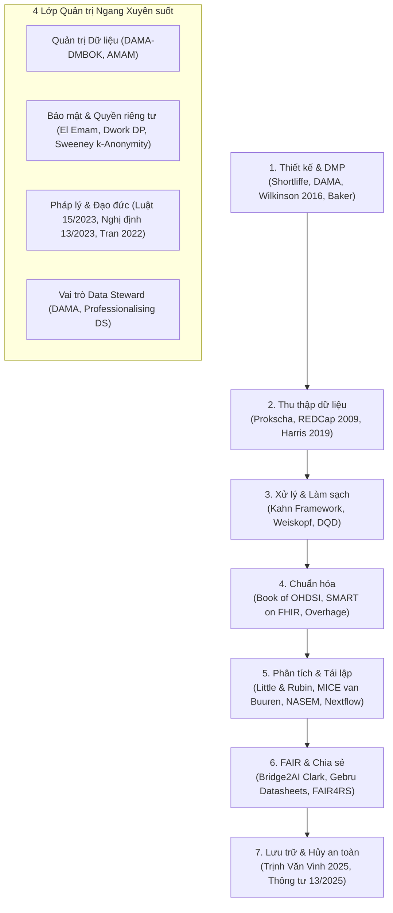

# Mục lục Hồ sơ Đánh giá Tài liệu Tham khảo (Literature Review Catalog)

**Dự án:** Chuyên khảo Quản lý Dữ liệu Nghiên cứu Y sinh (Biomedical Research Data Management)  
**Ngày cập nhật:** 2026-11-25 · **Tổng số tài liệu đã review:** 30  
**Nguồn dữ liệu siêu dữ liệu:** [OpenAlex API](https://openalex.org) & [Semantic Scholar Graph API](https://www.semanticscholar.org) (Xác thực 100% không suy diễn).

---

## 1. Bảng Tổng hợp Ma trận Tài liệu theo 9 Chương

| STT | Chương | Loại | Tiêu đề / Công trình | Năm | Trích dẫn (OA / S2) | Tệp hồ sơ chi tiết |
|:---:|:---|:---|:---|:---:|:---:|:---|
| 1 | CH01 | Textbook | **Biomedical Informatics: Computer Applications in Health Care and Biomedicine** | 2021 | 96 / 275 | [ch01-shortliffe2021-biomedical-informatics.md](file:///d:/Antigravity/biomedical-rdm/references/reviews/ch01-shortliffe2021-biomedical-informatics.md) |
| 2 | CH01 | Textbook / International Framework | **Data Governance Design with the DAMA-DMBOK Framework (Case Study: PT. XYZ)** | 2024 | 9 / 0 | [ch01-dama2017-dmbok2.md](file:///d:/Antigravity/biomedical-rdm/references/reviews/ch01-dama2017-dmbok2.md) |
| 3 | CH01 | SoTA Paper | **The FAIR Guiding Principles for scientific data management and stewardship** | 2016 | 22,093 / 18,105 | [ch01-wilkinson2016-fair-principles.md](file:///d:/Antigravity/biomedical-rdm/references/reviews/ch01-wilkinson2016-fair-principles.md) |
| 4 | CH01 | SoTA Paper | **1,500 scientists lift the lid on reproducibility** | 2016 | 5,326 / 3,689 | [ch01-baker2016-reproducibility-crisis.md](file:///d:/Antigravity/biomedical-rdm/references/reviews/ch01-baker2016-reproducibility-crisis.md) |
| 5 | CH02 | Textbook | **Practical Guide to Clinical Data Management** | 2024 | 32 / 50 | [ch02-prokscha2021-clinical-data-management.md](file:///d:/Antigravity/biomedical-rdm/references/reviews/ch02-prokscha2021-clinical-data-management.md) |
| 6 | CH02 | SoTA Paper | **Research electronic data capture (REDCap)—A metadata-driven methodology and workflow process for providing translational research informatics support** | 2008 | 55,153 / 48,707 | [ch02-harris2009-redcap-methodology.md](file:///d:/Antigravity/biomedical-rdm/references/reviews/ch02-harris2009-redcap-methodology.md) |
| 7 | CH02 | SoTA Paper | **The REDCap consortium: Building an international community of software platform partners** | 2019 | 26,144 / 21,637 | [ch02-harris2019-redcap-consortium.md](file:///d:/Antigravity/biomedical-rdm/references/reviews/ch02-harris2019-redcap-consortium.md) |
| 8 | CH03 | Monograph / Textbook | **The Book of OHDSI: Observational Health Data Sciences and Informatics** | n.d. | 0 / 0 | [ch03-ohdsi2021-book-of-ohdsi.md](file:///d:/Antigravity/biomedical-rdm/references/reviews/ch03-ohdsi2021-book-of-ohdsi.md) |
| 9 | CH03 | SoTA Paper | **SMART on FHIR: a standards-based, interoperable apps platform for electronic health records** | 2016 | 1,099 / 799 | [ch03-mandel2016-smart-on-fhir.md](file:///d:/Antigravity/biomedical-rdm/references/reviews/ch03-mandel2016-smart-on-fhir.md) |
| 10 | CH03 | SoTA Paper | **Observational Health Data Sciences and Informatics (OHDSI): Opportunities for Observational Researchers** | n.d. | 0 / 1,383 | [ch03-hripcsak2015-ohdsi-network.md](file:///d:/Antigravity/biomedical-rdm/references/reviews/ch03-hripcsak2015-ohdsi-network.md) |
| 11 | CH03 | SoTA Paper | **Validation of a common data model for active safety surveillance research** | 2012 | 620 / 540 | [ch03-overhage2012-omop-cdm-validation.md](file:///d:/Antigravity/biomedical-rdm/references/reviews/ch03-overhage2012-omop-cdm-validation.md) |
| 12 | CH04 | Textbook | **Statistical Analysis with Missing Data, Third Edition** | 2019 | 3,745 / 1,565 | [ch04-little-rubin2019-missing-data.md](file:///d:/Antigravity/biomedical-rdm/references/reviews/ch04-little-rubin2019-missing-data.md) |
| 13 | CH04 | Textbook | **Flexible Imputation of Missing Data, Second Edition** | 2018 | 3,276 / 254 | [ch04-vanbuuren2018-mice-imputation.md](file:///d:/Antigravity/biomedical-rdm/references/reviews/ch04-vanbuuren2018-mice-imputation.md) |
| 14 | CH04 | SoTA Paper | **A Harmonized Data Quality Assessment Terminology and Framework for the Secondary Use of Electronic Health Record Data** | 2016 | 872 / 620 | [ch04-kahn2016-harmonized-data-quality.md](file:///d:/Antigravity/biomedical-rdm/references/reviews/ch04-kahn2016-harmonized-data-quality.md) |
| 15 | CH04 | SoTA Paper | **Methods and dimensions of electronic health record data quality assessment: enabling reuse for clinical research** | 2012 | 1,550 / 1,221 | [ch04-weiskopf2013-ehr-data-quality-dimensions.md](file:///d:/Antigravity/biomedical-rdm/references/reviews/ch04-weiskopf2013-ehr-data-quality-dimensions.md) |
| 16 | CH04 | SoTA Paper | **Increasing trust in real-world evidence through evaluation of observational data quality** | 2021 | 147 / 98 | [ch04-blacketer2021-data-quality-dashboard.md](file:///d:/Antigravity/biomedical-rdm/references/reviews/ch04-blacketer2021-data-quality-dashboard.md) |
| 17 | CH05 | Textbook | **Guide to the De-Identification of Personal Health Information** | 2013 | 165 / 138 | [ch05-elemam2013-deidentification-guide.md](file:///d:/Antigravity/biomedical-rdm/references/reviews/ch05-elemam2013-deidentification-guide.md) |
| 18 | CH05 | Monograph / Textbook | **The Algorithmic Foundations of Differential Privacy** | 2014 | 11,470 / 10,679 | [ch05-dwork-roth2014-differential-privacy.md](file:///d:/Antigravity/biomedical-rdm/references/reviews/ch05-dwork-roth2014-differential-privacy.md) |
| 19 | CH05 | SoTA Paper | **k-ANONYMITY: A MODEL FOR PROTECTING PRIVACY** | 2002 | 10,212 / 9,323 | [ch05-sweeney2002-k-anonymity.md](file:///d:/Antigravity/biomedical-rdm/references/reviews/ch05-sweeney2002-k-anonymity.md) |
| 20 | CH05 | SoTA Paper | **L -diversity: Privacy beyond k -anonymity** | 2007 | 4,463 / 5,804 | [ch05-machanavajjhala2007-l-diversity.md](file:///d:/Antigravity/biomedical-rdm/references/reviews/ch05-machanavajjhala2007-l-diversity.md) |
| 21 | CH06 | SoTA Paper | **Digital Health Policy and Programs for Hospital Care in Vietnam: Scoping Review** | 2022 | 64 / 33 | [ch06-tran2022-digital-health-policies-vietnam.md](file:///d:/Antigravity/biomedical-rdm/references/reviews/ch06-tran2022-digital-health-policies-vietnam.md) |
| 22 | CH06 | SoTA Paper | **41. CHUYỂN ĐỔI SỐ TRONG QUẢN LÝ HỒ SƠ BỆNH ÁN ĐIỆN TỬ HƯỚNG TỚI XÂY DỰNG HỆ THỐNG Y TẾ THÔNG MINH, BỀN VỮNG** | 2025 | 0 / 0 | [ch06-trinhvanvinh2025-emr-vietnam.md](file:///d:/Antigravity/biomedical-rdm/references/reviews/ch06-trinhvanvinh2025-emr-vietnam.md) |
| 23 | CH07 | SoTA Paper | **AI-readiness Criteria for Biomedical Data in Functional Genomics and Clinical Medicine** | 2024 | 55 / 5 | [ch07-clark2024-ai-readiness-bridge2ai.md](file:///d:/Antigravity/biomedical-rdm/references/reviews/ch07-clark2024-ai-readiness-bridge2ai.md) |
| 24 | CH07 | SoTA Paper | **Datasheets for datasets** | 2021 | 5,613 / 4,190 | [ch07-gebru2021-datasheets-for-datasets.md](file:///d:/Antigravity/biomedical-rdm/references/reviews/ch07-gebru2021-datasheets-for-datasets.md) |
| 25 | CH07 | SoTA Paper | **Evaluating FAIR maturity through a scalable, automated, community-governed framework** | 2019 | 236 / 183 | [ch07-wilkinson2019-fair-metrics.md](file:///d:/Antigravity/biomedical-rdm/references/reviews/ch07-wilkinson2019-fair-metrics.md) |
| 26 | CH08 | Consensus Study Report / Textbook | **Reproducibility and Replicability in Science** | 2019 | 1,395 / 73 | [ch08-nasem2019-reproducibility-and-replicability.md](file:///d:/Antigravity/biomedical-rdm/references/reviews/ch08-nasem2019-reproducibility-and-replicability.md) |
| 27 | CH08 | SoTA Paper | **Nextflow enables reproducible computational workflows** | 2017 | 4,697 / 3,820 | [ch08-ditommaso2017-nextflow-reproducible-workflows.md](file:///d:/Antigravity/biomedical-rdm/references/reviews/ch08-ditommaso2017-nextflow-reproducible-workflows.md) |
| 28 | CH08 | SoTA Paper | **Introducing the FAIR Principles for research software** | 2022 | 747 / 522 | [ch08-barker2022-fair-principles-research-software.md](file:///d:/Antigravity/biomedical-rdm/references/reviews/ch08-barker2022-fair-principles-research-software.md) |
| 29 | CH09 | SoTA Paper | **Toward a science of learning systems: a research agenda for the high-functioning Learning Health System** | 2014 | 606 / 452 | [ch09-friedman2015-science-of-learning-health-systems.md](file:///d:/Antigravity/biomedical-rdm/references/reviews/ch09-friedman2015-science-of-learning-health-systems.md) |
| 30 | CH09 | SoTA Paper | **Factors associated with COVID-19-related death using OpenSAFELY** | 2020 | 7,389 / 4,822 | [ch09-williamson2020-opensafely-platform.md](file:///d:/Antigravity/biomedical-rdm/references/reviews/ch09-williamson2020-opensafely-platform.md) |

---

## 2. Phân bố Tài liệu theo 7 Giai đoạn Vòng đời Dữ liệu

---

## 3. Hướng dẫn Tái sử dụng và Liên kết trong Soạn thảo Chuyên khảo

Mỗi tệp review trong thư mục `references/reviews/` được biên soạn theo cấu trúc học thuật chuẩn hóa:
1. **Academic Metadata:** Toàn bộ DOI, số lượt trích dẫn, venue được lấy tự động trực tiếp từ OpenAlex và Semantic Scholar.
2. **Abstract & TLDR:** Văn bản tóm tắt nguyên bản giải mã từ Inverted Index của OpenAlex.
3. **Đóng góp phương pháp luận:** Phân tích sâu về lý thuyết và mô hình giải pháp.
4. **Ánh xạ chuyên khảo (Monograph Mapping):** Chỉ rõ vị trí đưa vào từng tiểu mục của chương, bài học sư phạm, và cảnh báo bẫy thực tế (Pitfalls & Common Misconceptions).
5. **Trích dẫn chuẩn:** Cung cấp sẵn định dạng APA 7th và khối BibTeX đồng bộ với hệ thống `references/references.bib`.
